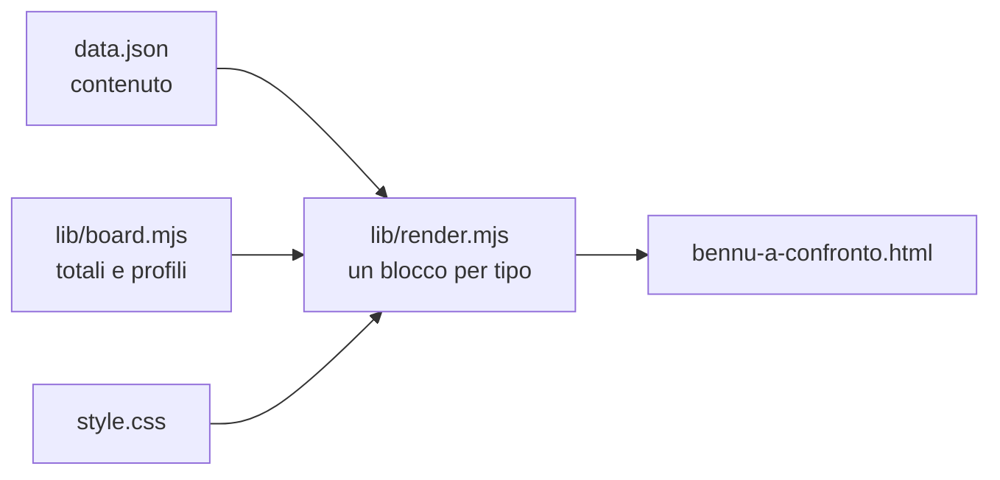

# Bennu a confronto — sorgenti della pagina

`docs/bennu-a-confronto.html` è **generata**: non si modifica a mano. Si cambia `data.json` (o `style.css`) e si lancia

```bash
node docs/bennu-a-confronto/build.mjs
```

La pagina esce senza script: totali, subtotali, percentuali, profili pesati e grafico sono calcolati qui, in fase di build.



## Dove si mette cosa

| Cosa cambia | Dove |
|---|---|
| Un voto, una nota, un peso | `scorecard[].rows[]` — `scores` per editor (chiavi di `tools`), `then` = voto della stesura precedente (`null` = riga nuova), `weight.legacy` / `weight.boot` |
| Una riga delle matrici di dettaglio | il blocco `matrix` della sezione: `f` (funzione), `why`, `tag`, e `v` con **una lettera per colonna** |
| Un asse, un fatto, un passo | i blocchi `axes`, `facts`, `steps`, `chart` |
| Prosa | i blocchi `p`, `callout`, `list`, `details` — HTML fidato, come scritto |
| Titolo, eyebrow, piè di pagina | `meta` |

Le lettere di `v`: `y` = ✓, `p` = ◐, `n` = ✗, `q` = «?».

## Numeri che la pagina calcola: nella prosa si scrivono come token

`{{areas}}` · `{{max}}` · `{{total:bennu}}` · `{{pct:iu}}` · `{{legacy:bennu}}` · `{{boot:ice}}`

Chiavi degli editor: `bennu`, `iu`, `ice`, `ecl`, `vsc`, `nb`. Un voto cambiato in `scorecard` aggiorna da solo la scheda, i profili e ogni frase che usa un token.

> [!WARNING] Restano a mano i numeri che nessuna riga calcola
> Le differenze («sei voti salgono, dieci punti»), i conteggi di test e crate e le percentuali di una sola parte della scheda sono scritti nella prosa:
> se cambia un voto vanno riletti.

## Un nuovo tipo di blocco

Una funzione in `BLOCKS` (`lib/render.mjs`), una regola in `style.css`. Un `t` sconosciuto in `data.json` fa fallire il build, non sparire il blocco.
