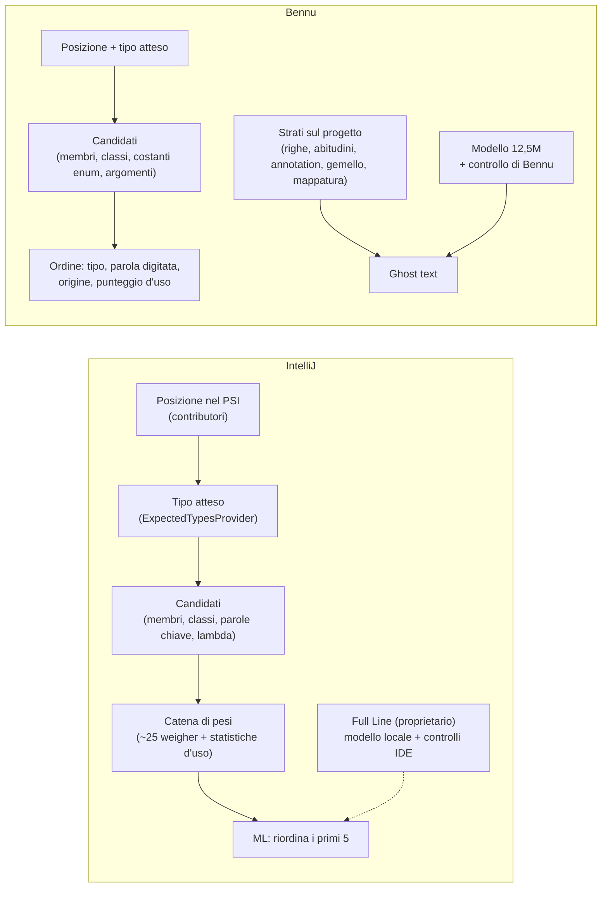

# Completamento Java: Bennu e IntelliJ a confronto

> Cosa fa il completamento di IntelliJ IDEA (letto dal suo codice open source) e cosa fa Bennu oggi, con i buchi che restano in ordine di valore.

**Come è stato fatto.** Tre letture in parallelo del repository IntelliJ Community (licenza Apache-2.0: ne sono state lette le *idee*, nessun codice è stato copiato). Il rapporto sulle istruzioni e i template ha letto quasi solo i nomi delle classi, quindi quei punti sono dedotti e segnati *(dedotto)*. Il plugin *Full Line Code Completion* è proprietario e **non** è nel repository: di quello si sa solo ciò che JetBrains ha pubblicato. Le affermazioni su Bennu vengono dal lavoro fatto in questo ramo; dove non le ho riverificate è scritto *(da verificare)*.

**Avvertenza sulla fonte.** In questa versione di IntelliJ la logica di parole chiave, nomi di membro, attributi di annotation e membri del tipo atteso si sta spostando su provider "ModCommand"; la strada vecchia (i `CompletionContributor`) resta per il completamento smart e a catena.

## In breve

> [!NOTE]
> **Lettura**
>
> IntelliJ ha molto più lavoro deterministico (tipo atteso ovunque, una lunga catena di pesi, statistiche di scelta) e mette il modello *sopra*. Bennu ha meno del primo, ma ha strati che IntelliJ non ha, costruiti sul codice del singolo progetto.

## 1. Il tipo atteso (ExpectedTypesProvider)

In IntelliJ ogni posizione che "vuole un tipo" lo dice, ed è la chiave del completamento smart.

| Posizione | IntelliJ | Bennu |
|---|---|---|
| Dichiarazione con tipo, assegnazione, `return`, condizione | sì | sì |
| Argomento di chiamata | **unione di tutti gli overload** possibili | un solo tipo, solo se tutti gli overload concordano |
| Argomento di `new` | sì | sì |
| Etichetta `case` | tipo del selettore, esclude le costanti già usate | sì, esclude le costanti già usate |
| Rami di un ternario | tipo del ternario o dell'altro ramo | sì |
| Operandi `==`, `!=` | sì | sì |
| Inizializzatore di array | tipo dell'elemento | sì |
| Operatori aritmetici, indice di array | sì | no |
| `throw`, `foreach`, `synchronized` | sì | no |
| `yield`, risultato di `switch`, corpo di lambda | sì | no |
| Valori di attributi di annotation | tipo dell'attributo | no (si usano le abitudini del progetto) |

> [!NOTE]
> **Cosa cambia per te**
>
> L'unione degli overload è il buco più concreto: con `pick(Cliente)` e `pick(Fornitore)` IntelliJ propone le classi di entrambi, Bennu non propone niente di "atteso".

## 2. Cosa propone dato il tipo atteso ("smart")

- **Filtro per assegnabilità**: solo i candidati compatibili (Bennu: ordina per tipo, non filtra).
- **Membri del tipo atteso senza qualificatore** (`JavaMembersGetter`): costanti e fabbriche statiche della classe attesa e costanti di enum, con import statico all'accettazione. Bennu: costanti di enum, **non** costanti e fabbriche in generale (`MediaType.APPLICATION_JSON_VALUE`, `HttpStatus.OK`, `Optional.empty()`).
- **`new` dei sottotipi** (`JavaInheritorsGetter`): Bennu ordina i nomi di classe per vicinanza al tipo atteso, ma non propone `new` dei sottotipi come voce.
- **Catena a un livello** (`a.getB().getC()` verso il tipo atteso): presente in entrambi.
- **Cast, `instanceof`, tipi di `catch`**: IntelliJ li ha tutti; Bennu ha i tipi di `catch` *(altri da verificare)*.
- **Slot funzionali**: IntelliJ offre voci `(a, b) ->` con i nomi dei parametri e riferimenti `Classe::metodo` per ogni metodo adatto. Bennu offre il tipo che la funzione riceve, e l'argomento abituale del progetto (`it -> it.nome()`, `Boolean.FALSE::equals`), ma non l'elenco dei riferimenti a metodo adatti.

## 3. Parole chiave

IntelliJ (`KeywordCompletionItemProvider`) decide per posizione: parole da istruzione a inizio istruzione, modificatori nel corpo di classe, `else` solo dopo un `if`, `catch`/`finally` dopo un `try`, `true`/`false` solo se si attende un boolean, parole di modulo solo in `module-info`. Poi le ordina con `PreferByKindWeigher`: `return` è "probabile" se è l'ultima istruzione e il metodo non è `void`, e `record` non lo è, per questo `return` vince.

Bennu fa lo stesso per posizione (`java-keywords.ts`) e mette `return` per primo nei metodi che restituiscono un valore. Mancano le sfumature dell'ordinamento: `true`/`false` per tipo atteso, `null` dopo `==`, `final` prima di una variabile, `break`/`continue` nei cicli.

## 4. Come ordina (il punto dove IntelliJ è più avanti)

Catena di pesi, il primo che differisce decide:

1. priorità esplicita, voci più corte, inizio del nome digitato, qualità del prefisso;
2. **statistiche d'uso** (`StatisticsWeigher`): quante volte hai *scelto* quella voce, per **contesto** (tipo del qualificatore + nome atteso, ad esempio il nome del parametro);
3. prossimità (stesso file, cartella, modulo, libreria);
4. per tipo di voce (`PreferByKindWeigher`): metodo di annotation, parola chiave probabile, variabile con il tipo atteso, lambda, riferimento a metodo, variabile locale, getter, costante del tipo atteso, metodo normale, classe…;
5. ricorsione, somiglianza del finale del nome, parole in comune col nome atteso, non generico, catene di metodi;
6. **metodi già chiamati nella catena in fondo** (`dispreferPreviousChainCalls`);
7. più usato nel progetto (indice dei riferimenti), più corto;
8. **ML**: riordina solo i primi 5 con un modello CatBoost (posizione, prefisso, caratteristiche della sessione e dell'utente).

| Idea | IntelliJ | Bennu |
|---|---|---|
| Voce scelta più spesso | per contesto (qualificatore + nome atteso), appreso dalle tue scelte | uso nel codice del progetto per nome del membro, **e** le tue scelte per contesto (ricevitore e posizione dell'argomento), su disco (`flc_choices`), con *Count how often suggestions are taken* acceso |
| Setter già chiamati in fondo | sì | sì (la catena del builder) |
| Parole in comune col nome atteso | sì (`PreferContainingSameWords`) | sì (enum e variabili per argomento) |
| Prossimità | file, cartella, modulo, libreria | vicinanza per le classi (import) |
| ML sul popup | sì, primi 5 | no (provato per il ghost text: meno di 1 punto, scartato) |

> [!NOTE]
> **Corretto: non è più un buco**
>
> Le statistiche di scelta per contesto (cosa scegli dopo un ricevitore o per un argomento) esistono: sono salvate su disco da `flc_choices` e mettono in testa fino a tre voci scelte almeno due volte. Restano due differenze con IntelliJ: i contesti sono il ricevitore e la posizione dell'argomento, non il nome atteso; e funzionano solo con il conteggio acceso.

## 5. Riempire gli argomenti

IntelliJ ha due meccanismi: un modello con un segnaposto per ogni parametro, che riempi tu con il completamento ordinato, e `SameSignatureCallParametersProvider`, che propone `a, b` quando la firma coincide con quella del metodo che contiene la chiamata. **Non** ha una funzione che scelga tra due variabili dello stesso tipo: decidono i pesi e le statistiche.

Bennu va oltre: propone la lista intera per tipo e nome, con l'abitudine del progetto per quella posizione, un'ipotesi (la prima dichiarata) quando due variabili vanno ugualmente bene, e un valore che compila (`null`, `0`, `false`, `""`) dove niente va bene.

## 6. Oltre il completamento

| Funzione | IntelliJ | Bennu |
|---|---|---|
| Completare l'istruzione corrente (`;`, parentesi, graffe, corpi) | circa 40 correzioni (`SmartEnter`) *(dedotto)* | da verificare |
| Template postfix | circa 40 (`.if`, `.for`, `.var`, `.sout`, `.try`, …) *(dedotto)* | parte (`.for` e simili) |
| Live template | 16 predefiniti *(dedotto)* | da verificare |
| Override, implementa, getter, setter, costruttore, `equals` | in completamento (`JavaGenerateMemberCompletionContributor`) | accessor mancanti |
| Nomi di variabile | per tipo, per nome del metodo, plurali, stile del progetto, nomi già usati | per tipo, più l'abitudine del progetto |
| Crea metodo dall'uso, importa al volo, import statico | sì | sì (metodo mancante) *(import statico da verificare)* |
| Valori di annotation, chiavi `application.properties` | attributi sì, chiavi Spring no (plugin a parte) | sì, anche le chiavi |

## 7. Dove Bennu è avanti

Cose che nel repository di IntelliJ non ci sono (tutte lette come assenti, tranne dove segnato):

- righe ripetute dal progetto, completate da altri file;
- corpo di un metodo gemello con i nomi sostituiti;
- annotation che il progetto scrive sempre, e quella che di solito segue;
- mappatura campo per campo tra due classi;
- argomento abituale per metodo e posizione, e profilo salvato per progetto e tra progetti;
- un modello locale piccolo con un veto sul codice che non compila (di Full Line si sa solo da fuori).

## 8. I buchi, in ordine di valore per te

1. ~~**Statistiche di scelta per contesto** nel popup~~ — già presenti (`flc_choices`); resta da aggiungere il nome atteso al contesto.
2. **Tipo atteso come unione degli overload** per gli argomenti, al posto di "tutti d'accordo".
3. **Membri del tipo atteso senza qualificatore**: costanti e fabbriche statiche (`MediaType.X`, `HttpStatus.X`, `Optional.empty()`), con import statico.
4. **Completare l'istruzione corrente** (`;`, parentesi, graffe), se non esiste già.
5. **Riferimenti a metodo adatti allo slot** (`Classe::metodo`), non solo l'abitudine del progetto.
6. **Sfumature delle parole chiave** (`true`/`false`, `null`, `final`, `break`/`continue`).
7. **Tipo atteso in più posizioni**: operatori, `throw`, `foreach`, corpo di lambda, `yield`.

> [!TIP]
> **Cosa conviene fare prima**
>
> 1 e 3 danno il guadagno più visibile nel tuo codice Spring; 2 chiude il caso dei metodi con overload; 4 va prima verificata nell'editor, perché potrebbe esistere già.
