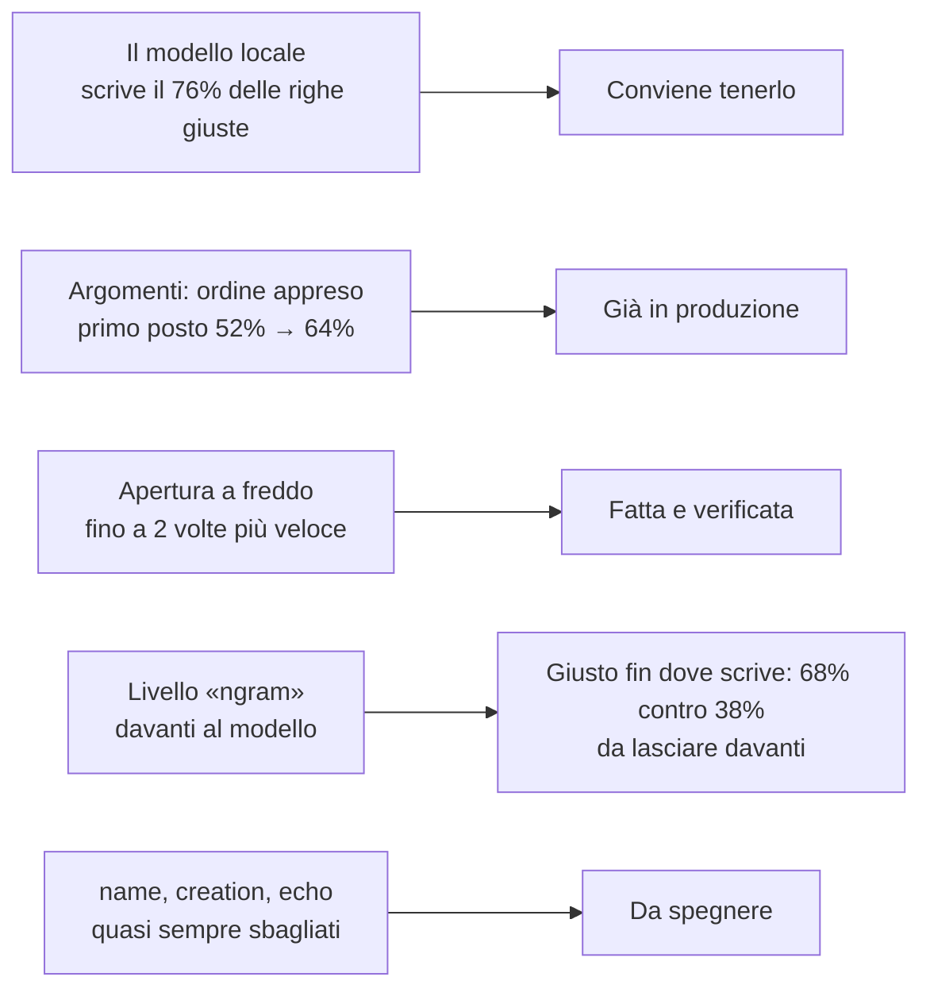
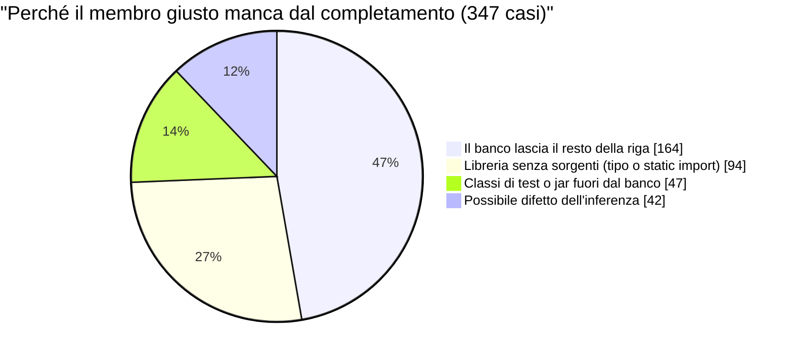

# Suggerimenti di Bennu: cosa abbiamo misurato, in breve

> Riepilogo per chi non ha seguito il lavoro. Tutte le misure sono fatte su codice **pubblico** (Commons Lang, Commons Text, Spring WebFlux e R2DBC), mai su codice privato. Il rapporto lungo, con i dettagli e i limiti di ogni misura, resta in [bennu-ml-bench.md](bennu-ml-bench.md).

## In una pagina



## 1. Chi propone le righe, dal migliore al peggiore

3170 righe tenute fuori, con il cursore a inizio parola. Il livello migliore è in alto.

| Livello | Righe proposte | Giuste | Giuste fra le proposte | Giusto fin dove scrive | Utili a metà riga |
|---|---|---|---|---|---|
| ngram | 260 | 65 | 25,0% | 68,1% | 47,5% |
| project | 255 | 147 | 57,6% | 58,8% | 63,0% |
| arglist_rest | 29 | 10 | 34,5% | 41,4% | 55,4% |
| habits | 73 | 0 | 0,0% | 39,7% | 10,0% |
| model | 1417 | 491 | 34,7% | 37,7% | 52,8% |
| arglist | 76 | 20 | 26,3% | 34,2% | 48,2% |
| created | 12 | 3 | 25,0% | 25,0% | 75,5% |
| creation | 50 | 0 | 0,0% | 14,0% | 8,2% |
| name | 168 | 0 | 0,0% | 4,2% | 2,9% |
| member_args | 9 | 0 | 0,0% | 0,0% | 12,1% |
| echo | 20 | 0 | 0,0% | 0,0% | 8,1% |
| derived | 24 | 0 | 0,0% | 0,0% | 0,0% |

> [!NOTE] Legenda della tabella 1
> - **Livello**: chi ha risposto. `model` è il modello locale; `project` copia righe che il progetto scrive uguali in più file; `arglist` e `arglist_rest` scrivono gli argomenti di una chiamata; `ngram` copia ciò che segue le stesse parole altrove nel progetto; gli altri sono livelli piccoli. L'ordine è per «Giusto fin dove scrive».
> - **Righe proposte**: quante volte quel livello ha mostrato un suggerimento. Esempio: `project` ha proposto 255 righe.
> - **Giuste**: quante coincidono, parola per parola, con **tutta** la riga che c'era davvero. Esempio: 147 delle 255 di `project`. Per chi scrive solo un pezzo di riga questa colonna è sempre 0.
> - **Giuste fra le proposte**: giuste divise per proposte. Esempio: 147 ÷ 255 = 57,6%.
> - **Giusto fin dove scrive**: il testo che il suggerimento mostra è l'inizio esatto della riga vera, anche se la riga continua. Esempio: `ngram` scrive in media 14 caratteri e nel 68,1% dei casi sono quelli giusti; il modello scrive righe intere e ne azzecca il 37,7%. Questa colonna giudica meglio chi propone un pezzo.
> - **Utili a metà riga**: quanta parte della riga vera (in media) coincide prima del primo errore. Penalizza chi scrive poco.
> - `derived` scrive blocchi di più righe, che questa misura (una riga sola) non sa valutare: lo 0% non è un giudizio.

### Il livello «ngram» davanti al modello: prima e dopo

| Cosa | Prima (senza ngram) | Ora (ngram davanti al modello) | Differenza |
|---|---|---|---|
| Righe coperte (su 3170 richieste) | 72,9% | 75,5% | +2,6 punti |
| Giuste fra le proposte (riga intera) | 32,1% | 30,7% | −1,4 punti |
| Giusto fin dove scrive | 36,4% | 39,5% | +3,1 punti |
| Righe giuste intere | 742 | 736 | −6 righe |
| Righe giuste fin dove scrive | 842 | 945 | +103 righe |
| Caratteri giusti mostrati | 26 726 | 27 212 | +486 |
| Caratteri sbagliati mostrati | 32 757 | 32 286 | −471 |

Dove `ngram` risponde al posto del modello (175 righe): `ngram` è giusto fin dove scrive in 132 (75%), il modello è giusto sulla riga intera in 71 (41%). In 79 righe `ngram` ha ragione e il modello no; in 18 il modello indovina la riga intera e `ngram` no.

> [!NOTE] Legenda della tabella «prima e dopo»
> - **Prima / Ora**: due prove identiche sulle stesse 3170 righe, con e senza il livello nuovo.
> - **Righe coperte**: la quota di richieste a cui è stato mostrato qualcosa. Esempio: 75,5% = 2394 richieste su 3170.
> - **Differenza**: Ora meno Prima, in punti percentuali o in righe. Esempio: 75,5 − 72,9 = +2,6 punti.
> - **Caratteri giusti / sbagliati mostrati**: somma, su tutte le righe proposte, dei caratteri iniziali giusti e di quelli che restano sbagliati. Il secondo numero è il tempo perso a cancellare.
> - La riga intera giusta sola (−6) dà un quadro peggiore del vero: `ngram` mostra spesso solo l'inizio, giusto, di una riga che il modello avrebbe scritto intera ma con un errore.

> [!IMPORTANT] La fiducia di «ngram» è onesta; era il metro a ingannare
> In una versione precedente di questo riepilogo la fiducia di `ngram` sembrava sbagliata (alta in 183 righe, ma giusta solo nel 4,9% dei casi). Era un errore di misura: quelle 183 sono suggerimenti **parziali** (il livello disegna le parole su cui quasi tutte le righe viste concordano, in media 14 caratteri invece di 28) e venivano giudicati sulla riga intera. Giudicati su ciò che mostrano sono giusti nel 65% (75% nelle altre 76), e la fiducia è in ordine: da 0,5 a 0,7 giusto 22%; da 0,7 a 0,9 il 59%; da 0,9 a 0,999 il 72%; 1,00 il 76%.

### Livelli deboli: spegnerli?

| Livello | Righe proposte | Giusto fin dove scrive | Caratteri giusti | Caratteri sbagliati | Cosa fare |
|---|---|---|---|---|---|
| name | 168 | 4,2% | 112 | 1832 | Spegnere |
| creation | 50 | 14,0% | 120 | 629 | Spegnere |
| echo | 20 | 0,0% | 73 | 513 | Spegnere |
| habits | 73 | 39,7% | 196 | 678 | Lasciare (giusto quanto il modello) |
| member_args | 9 | 0,0% | 32 | 155 | Lasciare: troppo pochi casi |
| derived | 24 | non misurabile | — | — | Lasciare: va misurato a blocchi |

| Cosa | Oggi | Con name, creation ed echo spenti | Differenza |
|---|---|---|---|
| Righe proposte (su 3170) | 75,5% | 68,0% | −7,5 punti |
| Giusto fin dove scrive | 39,5% | 43,2% | +3,7 punti |
| Righe giuste fin dove scrive | 945 | 931 | −14 righe |
| Caratteri sbagliati mostrati | 32 286 | 29 312 | −2974 |

> [!NOTE] Legenda delle tabelle sui livelli deboli
> - **Cosa fare**: «Spegnere» = il livello è quasi sempre sbagliato e fa perdere più caratteri di quanti ne faccia guadagnare. Esempio: `name` propone 168 volte, 4,2% di volte giusto, 1832 caratteri sbagliati contro 112 giusti. `habits` invece, che prima sembrava da spegnere, è giusto fin dove scrive quasi come il modello (39,7%).
> - **Con name, creation ed echo spenti**: stessa prova, togliendo le risposte di quei tre livelli e senza metterne altre al loro posto. Si perdono 14 righe giuste e si risparmiano quasi 3000 caratteri sbagliati.
> - Non è stato rilanciato il banco con i livelli davvero spenti (serve cambiare il codice del ghost text): i numeri sono ricalcolati dalla prova completa.

## 2. Quanto vale il modello

| Configurazione | Righe proposte | Giuste | Giuste fra le proposte | Utili a metà riga |
|---|---|---|---|---|
| Cascata intera (con il modello) | 2394 | 736 | 30,7% | 46,5% |
| Senza il modello | 977 | 245 | 25,1% | 37,4% |
| Solo le risposte del modello | 1417 | 491 | 34,7% | 52,8% |

> [!NOTE] Legenda della tabella 2
> - **Cascata intera**: tutti i livelli, il modello per ultimo. **Senza il modello**: solo gli altri livelli. **Solo le risposte del modello**: la parte della cascata a cui ha risposto lui.
> - Esempio: togliendo il modello restano 977 suggerimenti invece di 2394, e le righe giuste scendono da 736 a 245. Il modello da solo scrive i due terzi delle righe giuste (491 su 736).

## 3. Argomenti di una chiamata: il nuovo ordine

È già in produzione (`flc_rank.rs`). Si misura quante volte la variabile giusta è in cima all'elenco del completamento.

| Cosa | Oggi | Con il nuovo ordine | Differenza (punti) |
|---|---|---|---|
| Prima posizione, nessuna lettera battuta | 51,5% | 63,5% | +12,0 |
| Prime tre, nessuna lettera battuta | 80,0% | 83,7% | +3,7 |
| Prima posizione, una lettera battuta | 82,8% | 83,9% | +1,1 |
| Prime tre, una lettera battuta | 95,9% | 95,8% | −0,1 |

> [!NOTE] Legenda della tabella 3
> - **Oggi**: l'ordine che il completamento ha già, con le sue regole scritte a mano. **Con il nuovo ordine**: lo stesso elenco, riordinato da un piccolo modello appreso su codice pubblico.
> - **Prima posizione**: la variabile giusta è la prima. Esempio: con il cursore appena dopo `(` e nessuna lettera, passa dal 51,5% al 63,5%.
> - **Prime tre**: è fra le prime tre.
> - Misurato su 1500 posizioni in cui l'argomento è un semplice nome (variabile o campo): il 31% degli argomenti. Margine di errore ±2,5 punti.

### Il membro dopo il punto

| Cosa | Oggi | Con un ordine appreso (solo banco) | Differenza (punti) |
|---|---|---|---|
| Prima posizione, nessuna lettera | 20,0% | 23,2% | +3,2 |
| Prime tre, nessuna lettera | 30,8% | 36,8% | +6,0 |
| Prima posizione, una lettera | 39,2% | 40,4% | +1,2 |

Il guadagno è piccolo e **non è in produzione**. Il problema vero è un altro: nel 23% dei casi il completamento non elenca affatto il membro giusto.



> [!NOTE] Legenda del grafico e della tabella «membro dopo il punto»
> - **Con un ordine appreso (solo banco)**: prova di laboratorio, non attiva nell'editor.
> - **Nessuna lettera**: il cursore è subito dopo il punto. Esempio: `ordine.|` e si cerca `totale`.
> - Il grafico conta i 347 casi su 1500 in cui il membro vero non c'è nell'elenco. **47% è colpa del banco**: lasciava nel buffer il resto della riga (`assertEquals(40, r1., "x")`), cosa che un editor non ha. Tolto il resto della riga il completamento elenca il membro vero nell'**87%** dei casi, non nel 77%.
> - Un altro 41% sono tipi di librerie e classi di test che il banco non ha sul classpath (AssertJ, EasyMock, moduli di test). Restano **al massimo 42 casi (12%) che possono essere difetti dell'inferenza**; tre confermati con repro: `getClass()` su un array di `boolean[]`, un metodo generico del progetto (`<T> T id(T)`) e `requireNonNull(s, "msg")`.
> - Il dettaglio con i repro in Java è nel rapporto lungo.

## 4. Metodi interi: ritrovarli, adattarli, controllarli

Per ogni metodo tenuto fuori (corpo di 1–8 istruzioni) si cercano i 5 più simili per nome e firma (stessa quantità di parametri), si adattano i nomi (parametri per posizione, proprietà derivata da `getX` → `x`, gli altri nomi dall'elenco che dà il nuovo ordine degli argomenti) e il controllo di Bennu dice se il corpo compila. 600 metodi, scelti uguali per ogni progetto.

| Tipo di metodo | Metodi | Qualcosa proposto | Compila | Esatto | Esatto nella forma | Righe giuste per metodo |
|---|---|---|---|---|---|---|
| setter | 7 | 100% | 100% | 57,1% | 57,1% | 0,57 su 1,00 |
| getter | 25 | 100% | 88,0% | 44,0% | 48,0% | 0,44 su 1,00 |
| delega a un altro oggetto | 37 | 100% | 70,3% | 21,6% | 37,8% | 0,22 su 1,00 |
| CRUD | 63 | 100% | 77,8% | 14,3% | 25,4% | 0,48 su 2,05 |
| validazione | 10 | 100% | 80,0% | 10,0% | 10,0% | 0,20 su 1,90 |
| altro | 431 | 99,8% | 76,6% | 9,3% | 21,8% | 0,68 su 2,90 |
| conversione | 27 | 100% | 59,3% | 7,4% | 11,1% | 0,48 su 2,22 |
| **tutti** | 600 | 99,8% | 76,3% | 12,5% | 24,0% | 0,60 su 2,55 |

> [!NOTE] Legenda della tabella 4
> - **Qualcosa proposto**: esiste almeno un metodo simile con lo stesso numero di parametri da adattare.
> - **Compila**: il corpo proposto non porta errori che il corpo vero non avesse già (il controllo di Bennu, sul file intero). Esempio: per i getter 88% dei casi. Compilare non vuol dire essere giusto.
> - **Esatto**: il corpo proposto è identico, istruzione per istruzione, a quello vero. Esempio: 12,5% dei 600.
> - **Esatto nella forma**: stessa struttura con nomi e numeri diversi (`return x;` al posto di `return y;`).
> - **Righe giuste per metodo**: in media quante istruzioni vere compaiono tali e quali, rispetto a quante ne ha il metodo. Esempio: «0,60 su 2,55».
> - Il campione è piccolo per le classi rare (setter: 7 metodi): leggere le percentuali con cautela.

### Getter e setter: un livello apposito

Per i due tipi in cui il recupero rende, scrivere il corpo da sé (dal campo con lo stesso nome e tipo) è più sicuro. Nuovo livello `flc_body.rs`, non ancora agganciato, provato su tutti i getter e setter tenuti fuori:

| Tipo | Metodi chiamati getX / setX | Il livello propone | Esatto fra le proposte |
|---|---|---|---|
| setter | 616 | 51,1% | 78,7% |
| getter (get, is, has) | 2266 | 23,6% | 74,2% |

> [!NOTE] Legenda della tabella «getter e setter»
> - **Metodi chiamati getX / setX**: tutti quelli con quel nome nel codice di prova, anche se fanno altro (un `getX` che calcola non è un accessorio).
> - **Il livello propone**: c'è un campo con quel nome e quel tipo. Senza, tace. Esempio: 51,1% = per più della metà dei setter.
> - **Esatto fra le proposte**: il corpo coincide con quello vero. Gli errori sono quasi sempre di stile: `return this.x;` al posto di `return x;` quando il file non ha altri accessor da imitare, o una copia difensiva (`x.clone()`).
> - Per i metodi con campi di tipo array il livello tace.

## 5. Un'alternativa senza rete neurale al posto del modello

Copia di righe già scritte (n-grammi di parole). Mostra solo se ha già visto le stesse parole almeno due volte.

| Fiducia della copia almeno | Righe proposte | Giuste fra le proposte | Righe giuste del modello che riproduce |
|---|---|---|---|
| 0,3 | 857 | 46,1% | 17,8% |
| 0,5 | 606 | 57,3% | 16,7% |
| 0,7 | 307 | 82,7% | 12,1% |
| 0,9 | 236 | 88,1% | 9,4% |

> [!NOTE] Legenda della tabella 5
> - **Fiducia della copia almeno**: la quota di volte in cui, dopo le stesse parole, il progetto ha scritto la stessa cosa. Esempio: 0,7 = almeno 7 volte su 10.
> - **Righe giuste del modello che riproduce**: delle 562 righe che il modello indovina, quante indovinerebbe anche la copia. Esempio: a 0,7 solo il 12,1%.
> - Conclusione: la copia è molto precisa ma scrive **altre** righe (ne azzecca molte che il modello sbaglia) e non sostituisce il modello. Uno stack senza rete neurale (livelli deterministici + copia) scrive 390 delle 742 righe giuste: 53%.

## 6. Apertura a freddo di un progetto

Tempo per aprire un progetto la prima volta (indice dei simboli + giro dei riferimenti), compilazione di rilascio. Identico il risultato: stessi riferimenti trovati e stessa risposta di «trova usi» su 400 posizioni per progetto.

| Progetto e lavoratori | Prima (secondi) | Dopo (secondi) | Differenza (secondi) |
|---|---|---|---|
| Commons Lang, 1 lavoratore (impostazione attuale) | 6,6 | 5,7 | −0,9 |
| Commons Lang, 4 lavoratori | 2,8 | 2,2 | −0,6 |
| Spring (3926 file), 1 lavoratore (impostazione attuale) | 17,0 | 13,3 | −3,7 |
| Spring (3926 file), 4 lavoratori | 9,3 | 5,0 | −4,3 |

> [!NOTE] Legenda della tabella 6
> - **Lavoratori**: quanti processori usa la preparazione in background. L'impostazione di fabbrica è 1 (uno solo, per non rallentare l'editor); a 4 l'apertura è molto più rapida ma usa più CPU.
> - **Prima / Dopo**: prima e dopo la modifica a `jdk.rs`: un tipo che sta in un pacchetto che il JDK non ha non viene più cercato nell'immagine del JDK sotto un lucchetto condiviso. Esempio: Spring a 4 lavoratori da 9,3 a 5,0 secondi (1,9 volte più veloce).
> - A caldo (progetto già indicizzato) l'apertura resta di 0,1–0,4 secondi per il giro dei riferimenti: non cambia.
> - Non sono stati cambiati l'impostazione dei lavoratori (scelta di prodotto) né l'indice dei simboli, che si ricostruisce a ogni apertura (1–2,4 secondi).

## 7. Il giro dei riferimenti con le librerie

Oggi il giro dei riferimenti conosce solo il JDK e il progetto; le librerie (jar) restano fuori. Provato sulle librerie vere, su due progetti pubblici aperti con il loro `pom.xml`, aspettando che le librerie siano pronte prima del giro.

| Progetto | Riferimenti risolti (solo JDK) | Riferimenti risolti (con librerie) | Differenza | Posizioni di «trova usi» con risposta, su 600 (solo JDK → con librerie) | Tempo a freddo (solo JDK → con librerie) | Tempo a caldo (solo JDK → con librerie) |
|---|---|---|---|---|---|---|
| commons-text (220 file) | 34 159 | 34 192 | +33 (+0,1%) | 599 → 599 | 0,2 s → 1,4 s | 0,0 s → 0,2 s |
| jackson-databind (1402 file) | 235 440 | 248 647 | +13 207 (+5,6%) | 549 → 600 | 4,0 s → 5,3 s | 0,2 s → 0,3 s |

> [!NOTE] Legenda della tabella 7
> - **Riferimenti risolti**: quanti riferimenti nel codice il giro riesce a ricondurre a una dichiarazione. Esempio: per jackson-databind sale dal 92,7% al 97,3% dei riferimenti tentati.
> - **Posizioni con risposta**: su 600 punti scelti, in quanti «trova usi» sa rispondere. Esempio: 51 posizioni di jackson-databind che prima non avevano risposta.
> - **Tempo**: giro dei riferimenti più, con le librerie, l'attesa che le librerie siano pronte (1,2–1,3 s). Il giro in sé costa quanto prima (3,8 s). A caldo la cache dei riferimenti c'è comunque.

Risultato **non identico** per il resto: su 600 posizioni, 547 uguali, 51 che ora hanno risposta, una con 6 usi in più e **una che ne perde 18** (`f.enabledIn(...)` su `DatatypeFeature`: con le librerie il nome si risolve sulla classe del jar, di un'altra versione di Jackson, invece che su quella del progetto). Per questo non è stato adottato: la regola «il risultato resta identico per tutto il resto» non regge, e la cache dei riferimenti non è legata all'elenco dei jar (una cache scritta con le librerie e riletta senza, o viceversa, sarebbe sbagliata). Il giro con le librerie resta quello che era: attivabile con `BENNU_RENAME_FULL_RESOLVER=1`, ma in pratica non fa nulla perché parte prima che le librerie siano pronte.

## 8. Somiglianza dei nomi con vettori (M6)

Domanda: se i nomi si confrontano con vettori di sotto-parole imparati dal codice pubblico (invece che per parole in comune), si ritrova più spesso lo scheletro giusto? Stessi 2400 metodi di prima, addestramento solo sui progetti pubblici di addestramento. Percentuali di metodi con lo scheletro giusto fra i primi 20; ogni cella riporta «parole / vettori / mista».

| Tipo di metodo | Metodi | Primo posto (parole / vettori / mista) | Fra i primi 5 | Fra i primi 20 | Differenza vettori | Differenza mista |
|---|---|---|---|---|---|---|
| Lettura (getter) | 106 | 53,8 / 52,8 / 53,8 | 77,4 / 72,6 / 75,5 | 88,7 / 91,5 / 88,7 | +2,8 | 0,0 |
| Scrittura (setter) | 37 | 43,2 / 56,8 / 45,9 | 83,8 / 97,3 / 91,9 | 94,6 / 100 / 97,3 | +5,4 | +2,7 |
| Inoltro a un altro metodo | 124 | 31,5 / 36,3 / 37,1 | 57,3 / 49,2 / 57,3 | 66,1 / 58,1 / 66,9 | -8,1 | +0,8 |
| Salvataggio, ricerca, cancellazione | 265 | 21,1 / 26,0 / 22,6 | 36,6 / 38,9 / 38,5 | 43,4 / 44,5 / 42,6 | +1,1 | -0,8 |
| Conversione | 111 | 13,5 / 16,2 / 14,4 | 23,4 / 25,2 / 23,4 | 30,6 / 32,4 / 31,5 | +1,8 | +0,9 |
| Controllo | 69 | 18,8 / 21,7 / 20,3 | 33,3 / 30,4 / 31,9 | 37,7 / 40,6 / 39,1 | +2,9 | +1,4 |
| Tutto il resto | 1688 | 22,0 / 23,5 / 25,0 | 38,7 / 36,9 / 40,9 | 45,9 / 44,7 / 47,1 | -1,2 | +1,2 |
| **Non banali (conversione, controllo, resto)** | 1868 | 21,4 / 23,0 / 24,2 | 37,6 / 36,0 / 39,5 | 44,6 / 43,8 / 45,9 | -0,9 | +1,2 |
| **Tutti** | 2400 | 23,7 / 25,9 / 26,3 | 41,0 / 39,5 / 42,7 | 48,3 / 47,6 / 49,3 | -0,8 | +1,0 |

> [!NOTE] Come leggere la tabella
> «Parole» è la somiglianza di oggi (parole del nome e tipi della firma in comune). «Vettori» è il coseno fra vettori imparati. «Mista» è metà e metà. Il corpo identico fra i primi 20 resta uguale (18,0 / 18,3 / 18,6 su tutti). Le classi piccole (setter 37, getter 106) oscillano di diversi punti per puro caso.

**Esempi** in cui i vettori trovano uno scheletro che le parole mancano (codice pubblico, senza parole in comune): `String welcome() { return "welcome"; }` trova `String param2() { return ""; }`; `T rethrow(Throwable t) { return ExceptionUtils.<T, RuntimeException>eraseType(t); }` trova `T asRuntimeException(Throwable t)` con lo stesso corpo; `boolean isSet(OPTION o) { return options.contains(o); }` trova `boolean cancel(boolean b) { return delegate.cancel(b); }`. Il secondo è un vero guadagno, gli altri due somigliano al caso.

> [!IMPORTANT] Non vale la pena addestrare una rete vera, per ora
> Lo scheletro fra i primi 20 sale di +1,0 punti sul totale e di +1,2 sui non banali, contro la soglia di +5 e +10. Quel che i vettori guadagnano in una classe lo perdono in un'altra (inoltri -8,1 da soli). Il limite è probabilmente la quantità di codice per imparare (cinque progetti), non l'idea.

## 9. Indovinare la prossima istruzione dalla struttura già scritta (M7)

Si taglia un metodo dopo le prime k istruzioni e si chiede: di che *forma* è la k+1-esima (nomi e valori cancellati, restano solo la struttura)? Si cercano i metodi con la stessa apertura (stessa sequenza di forme dall'inizio, a parità la firma più simile) e si guarda la loro istruzione successiva. Stessi 2400 metodi di prima; percentuali di casi in cui la forma giusta è prima / fra le prime 3 / fra le prime 5.

| Istruzioni già scritte | Casi | Apertura lunga | Solo l'istruzione sopra (come oggi) | Sequenza delle ultime 3 forme | Istruzione esatta dopo il riempimento |
|---|---|---|---|---|---|
| 1 | 1305 | 47,4 / 57,0 / 59,6 | 25,3 / 36,1 / 41,2 | 27,8 / 39,1 / 43,8 | 30,9% |
| 2 | 937 | 46,6 / 56,1 / 58,2 | 31,7 / 43,6 / 48,2 | 44,5 / 51,5 / 53,1 | 30,2% |
| 3 | 674 | 48,7 / 55,0 / 56,8 | 33,7 / 44,4 / 48,8 | 47,5 / 52,7 / 53,6 | 33,1% |
| 4 | 443 | 42,4 / 48,8 / 52,4 | 32,7 / 42,7 / 47,4 | 48,5 / 53,3 / 54,2 | 26,9% |
| 5 | 282 | 48,9 / 55,3 / 55,7 | 32,6 / 46,8 / 49,6 | 47,9 / 53,2 / 53,9 | 35,5% |
| 6 | 148 | 41,2 / 47,3 / 48,6 | 32,4 / 41,2 / 45,9 | 48,0 / 52,7 / 54,7 | 31,8% |
| 7 | 57 | 49,1 / 50,9 / 54,4 | 35,1 / 43,9 / 47,4 | 49,1 / 49,1 / 50,9 | 36,8% |
| **Tutti** | 3846 | 46,7 / 54,9 / 57,2 | 30,1 / 41,2 / 45,9 | 40,3 / 47,8 / 50,3 | 31,1% |

| Tipo di metodo | Casi | Apertura lunga | Solo l'istruzione sopra | Sequenza delle ultime 3 forme | Istruzione esatta |
|---|---|---|---|---|---|
| Salvataggio, ricerca, cancellazione | 293 | 36,2 / 42,0 / 44,7 | 21,8 / 29,4 / 31,4 | 28,0 / 32,1 / 34,8 | 26,3% |
| Conversione | 143 | 30,8 / 39,9 / 41,3 | 16,1 / 21,0 / 24,5 | 21,7 / 27,3 / 28,7 | 23,8% |
| Controllo | 53 | 45,3 / 49,1 / 49,1 | 20,8 / 24,5 / 26,4 | 32,1 / 35,8 / 35,8 | 35,8% |
| Tutto il resto | 3357 | 48,4 / 56,8 / 59,0 | 31,6 / 43,4 / 48,3 | 42,3 / 50,3 / 52,8 | 31,8% |

> [!NOTE] Come leggere le tabelle
> «Apertura lunga» cerca i metodi che cominciano con la stessa sequenza di forme. «Solo l'istruzione sopra» imita il livello di oggi (`flc_sequence`) ma sulle forme: conta quale forma segue più spesso quella appena scritta. «Sequenza delle ultime 3 forme» è la stessa tabella con le ultime 1, 2 o 3 forme. Gli ultimi due non producono testo, solo forme: per questo «istruzione esatta» c'è solo per l'apertura lunga (nomi riempiti per posizione dei parametri, proprietà derivata e ordinatore degli argomenti). Il metodo che sta indovinando non contribuisce mai alle tabelle.

**Quanta parte del guadagno viene dall'apertura lunga?** Pochissima. Primo posto, tutti i casi:

| Apertura usata per cercare | Forma giusta al primo posto | Fra le prime 5 | Primo posto, solo da 3 istruzioni in su |
|---|---|---|---|
| Solo l'istruzione sopra | 30,1 | 45,9 | 33,2 |
| Sequenza delle ultime 3 forme | 40,3 | 50,3 | 47,9 |
| Solo la prima istruzione | 44,0 | 56,4 | 42,6 |
| Le prime 2 | 46,1 | 57,1 | 44,8 |
| Le prime 3 | 46,7 | 57,2 | 46,3 |
| Tutta l'apertura | 46,7 | 57,2 | 46,3 |

> [!IMPORTANT] Il guadagno sta nella prima istruzione e nella firma, non nell'apertura lunga
> Dai 30,1% di oggi ai 46,7%: 13,9 punti arrivano già con la sola prima istruzione (più la firma, che decide i pareggi), 2,1 con la seconda, 0,6 con la terza, nulla dopo. Da 3 istruzioni in su la semplice sequenza delle ultime forme (47,9%) fa **meglio** dell'apertura lunga (46,3%) al primo posto; l'apertura lunga è appena meglio solo fra le prime 5 (54,6 contro 53,8). Quando però il miglior vicino ha *tutta* l'apertura in comune (62% dei casi) la forma giusta è prima nel 66,8%; con un pezzo solo scende al 16,7%, con niente al 10,4%.

Nel confronto con l'istruzione esatta: 31,1% con l'apertura lunga, 29,8% con la sola prima istruzione.

## 10. Metodi tagliati in porzioni (M8)

Qui si usano i metodi con 2–30 istruzioni (10 629 metodi tenuti fuori, 28 087 porzioni). Una «porzione» è un pezzo di corpo con uno scopo. Due modi di tagliarla: dal flusso dei dati (una nuova porzione comincia quando l'istruzione non usa più le variabili definite o cambiate in quella corrente) e dalla mano dell'autore (riga vuota o commento di riga fra due istruzioni).

**(a) I due tagli coincidono?** Solo sui metodi che hanno almeno una riga vuota fra due istruzioni.

| Confronto | Metodi | Precisione | Richiamo | F1 | F1 medio per metodo |
|---|---|---|---|---|---|
| Flusso dei dati contro righe vuote | 3050 | 38,2 | 40,0 | 39,1 | 31,5 |
| Flusso dei dati contro righe vuote o commenti | 3050 | 38,8 | 39,8 | 39,3 | 31,7 |
| Per confronto: tagliare ad ogni istruzione | 3050 | 31,4 | 100,0 | 47,8 | 52,7 |

> [!NOTE] Come leggere la tabella
> Precisione: dei tagli del flusso dei dati, quanti l'autore li ha fatti davvero. Richiamo: dei tagli dell'autore, quanti il flusso li ritrova. L'ultima riga è il metodo più ingenuo (un taglio dappertutto): ha richiamo pieno per costruzione.

> [!WARNING] Il flusso dei dati non ritrova i tagli dell'autore
> La precisione (38%) supera di poco la frequenza di base (31%), e come F1 il taglio ovunque fa meglio. Il flusso dei dati divide troppo: 2,64 porzioni per metodo e il 61% di porzioni di una sola istruzione. Va bene come segmentatore per capire cosa fa un metodo, non come sostituto dei tagli dell'autore.

**(b) Ruoli** (percentuale delle porzioni; ruolo dedotto dalla struttura).

| Tipo di metodo | Metodi | Porzioni per metodo | Guardia | Preparazione | Ciclo | Try/catch | Costruzione | Campi | Ritorno | Effetto |
|---|---|---|---|---|---|---|---|---|---|---|
| Salvataggio, ricerca, cancellazione | 779 | 1,97 | 6,5 | 27,1 | 8,7 | 1,4 | 26,3 | 4,7 | 16,0 | 9,4 |
| Conversione | 310 | 1,98 | 7,2 | 18,1 | 8,6 | 1,5 | 43,0 | 0,2 | 16,1 | 5,4 |
| Controllo | 180 | 1,94 | 10,6 | 18,6 | 16,6 | 2,9 | 15,1 | 1,7 | 30,6 | 4,0 |
| Tutto il resto | 9360 | 2,73 | 1,3 | 13,9 | 3,1 | 0,8 | 41,1 | 2,0 | 5,0 | 32,8 |
| **Tutti** | 10 629 | 2,64 | 1,8 | 14,8 | 3,7 | 0,8 | 40,0 | 2,1 | 6,2 | 30,6 |

> [!NOTE] Come sono scelti i ruoli
> Primo che vale, in quest'ordine: guardia (solo `if` con `throw`/`return` o controlli tipo `requireNonNull`), try/catch, ciclo, campi (assegnazioni a ciò che non è una variabile locale), ritorno (solo `return`/`throw`), costruzione (c'è un `new`, una lambda o una chiamata `to…`/`build…`/`create…`), preparazione (dichiarazioni e assegnazioni), effetto (il resto, cioè chiamate). Sono regole grezze, non un'etichettatura verificata a mano; «ciclo» non controlla che accumuli.

**(c) Il vocabolario delle porzioni basta a costruire un metodo?** Quota delle porzioni tenute fuori la cui forma è fra le K più frequenti dei progetti di addestramento.

| Porzioni di | Porzioni | K=20 | K=50 | K=200 | K=1000 | Una forma qualsiasi dell'addestramento | Vista nel resto dello stesso progetto | Una delle due |
|---|---|---|---|---|---|---|---|---|
| 1 istruzione | 17 029 | 12,1 | 14,7 | 19,0 | 25,0 | 28,5 | 80,4 | 81,1 |
| 2 istruzioni | 4021 | 0,0 | 0,0 | 0,1 | 2,0 | 3,0 | 44,3 | 45,0 |
| 3 o più | 7037 | 0,0 | 0,0 | 0,1 | 0,2 | 0,3 | 37,7 | 37,8 |
| **Tutte** | 28 087 | 7,3 | 8,9 | 11,5 | 15,5 | 17,8 | 64,5 | 65,1 |

> [!IMPORTANT] Un vocabolario fisso di porzioni non esiste; il codice si ripete dentro il progetto
> I progetti di addestramento hanno 7820 forme diverse e le prime 1000 coprono il 15,5% delle porzioni tenute fuori (25% per quelle di una istruzione, 2% e 0,2% per quelle più lunghe). Ma le stesse forme compaiono per il 64,5% nel resto dello stesso progetto (38–44% per le porzioni di più istruzioni). Un metodo per porzioni funziona se impara dal progetto aperto, non da un catalogo portato da fuori.

**(d) Ritrovare la forma della porzione** con «ruolo + tipi in ingresso + nome del metodo»: la forma giusta è fra le prime 20 trovate? (8107 porzioni.)

| Porzioni | Quante | Forma fra le prime 20 |
|---|---|---|
| **Tutte** | 8107 | 50,1% |
| Di 1 istruzione | 4525 | 59,2% |
| Di 2 istruzioni | 1259 | 40,3% |
| Di 3 o più | 2323 | 37,6% |
| Forma fra le 1000 più frequenti | 1462 | 82,3% |
| Forma più rara | 6645 | 43,0% |
| Ruolo ritorno | 621 | 80,2% |
| Ruolo campi | 210 | 63,8% |
| Ruolo effetto | 2144 | 58,0% |
| Ruolo preparazione | 1273 | 49,6% |
| Ruolo guardia | 168 | 48,8% |
| Ruolo costruzione | 3255 | 41,6% |
| Ruolo ciclo | 336 | 30,1% |
| Ruolo try/catch | 100 | 16,0% |

> [!WARNING] Il 50,1% non è migliore del 48,3% dello scheletro intero
> Il confronto non è alla pari (qui metodi di 2–30 istruzioni, lì 1–8), ma il 50,1% è tenuto in alto dalle porzioni di una sola istruzione (56% delle porzioni); quelle di più istruzioni, che sono le interessanti, stanno al 38–40%, sotto il metodo intero. Il merito è soprattutto del progetto stesso: i vicini vengono anche dal resto del progetto aperto.

**Cinque metodi tagliati** (codice pubblico; la riga «anche l'autore ha separato qui» segna dove nel sorgente c'era una riga vuota o un commento):

```java
boolean isInitialized() {
    // --- preparazione
    byte isInitialized = memoizedIsInitialized;
    if (isInitialized == 1) return true;
    if (isInitialized == 0) return false;
    // --- campi · anche l'autore ha separato qui
    memoizedIsInitialized = 1;
    // --- ritorno
    return true;
}
```

```java
void noMatchBecauseNotSupported() {
    // --- campi
    this.view = new HttpMessageWriterView(new Jaxb2XmlEncoder());
    // --- costruzione
    this.view.setModelKeys(Set.of("foo1"));
    // --- effetto
    this.model.put("foo1", "bar1");
    // --- effetto · anche l'autore ha separato qui
    assertThat(doRender()).isEmpty();
}
```

```java
CloseableCounter initializeInternal() {
    // --- campi
    initializeCalls++;
    // --- campi
    currentExecutor = getActiveExecutor();
    // --- effetto · anche l'autore ha separato qui
    if (waitForLatch) { latch.await(); }
    // --- guardia · anche l'autore ha separato qui
    if (ex != null) { throw ex; }
    // --- ritorno · anche l'autore ha separato qui
    return counter.increment();
}
```

```java
void testSubstituteDefaultProperties() {
    // --- preparazione
    final String org = "${doesnotwork}";
    // --- effetto
    System.setProperty("doesnotwork", "It works!");
    // --- costruzione · anche l'autore ha separato qui
    final Properties props = new Properties(System.getProperties());
    assertEquals("It works!", StrSubstitutor.replace(org, props));
}
```

```java
void matrixVariable(HttpServer httpServer) {
    // --- effetto
    startServer(httpServer);
    // --- preparazione · anche l'autore ha separato qui
    String expected = "p=11, q2=22, q4=44";
    // --- costruzione
    String url = "/first;p=11/second;q=22/third-fourth;q=44";
    assertThat(performGet(url, new HttpHeaders(), String.class).getBody()).isEqualTo(expected);
}
```

Gli esempi mostrano anche i difetti: `this.view = new …` è un campo ma anche una costruzione, e `if (waitForLatch) { … }` finisce in «effetto» perché non ha né `throw` né `return`.

## 11. Metodi alla Spring Data: il nome letto in un vocabolario (M9)

L'idea: il nome del metodo (`findByEmail`, `countByStatus`, `toDto`) si legge con una grammatica fissa — azione, soggetto, condizioni dopo `By`, ordinamento, forma del risultato — e il corpo si compone da metodi del **progetto aperto** con la stessa azione, la stessa forma di risultato e gli stessi parametri, cambiando le parole del nome dentro gli identificatori (`ClienteRepository` → `FornitoreRepository`). Nessun catalogo da fuori.

**Quanta parte del codice la grammatica legge** (tutti i metodi dei tre progetti tenuti fuori):

| Progetto | Metodi | Nome letto | Di questi, con una condizione `By…` |
|---|---|---|---|
| commons-lang | 10 846 | 24,2% | quasi nessuno |
| commons-text | 2661 | 21,8% | quasi nessuno |
| spring-reactive | 6330 | 34,3% | quasi nessuno |
| **Tre progetti** | 19 837 | **27,1%** | |

> [!NOTE] Cosa vuol dire «letto»
> Il primo verbo del nome è un'azione conosciuta (cerca, conta, esiste, cancella, salva, converti, controlla, imposta, costruisci) e le eventuali condizioni dopo `By` corrispondono a parametri o campi della classe. In questi progetti i nomi letti sono quasi tutti accessori e conversioni (`getX`, `isX`, `setX`, `toX`): le condizioni `By…` non ci sono.

**Dove la grammatica vale di più: le applicazioni Spring** (tutti i metodi, anche quelli senza corpo):

| Applicazione | Metodi | Nome letto | Con condizione `By…` | Senza corpo |
|---|---|---|---|---|
| spring-petclinic (tutto) | 87 | 66,7% | 1,1% | 5,7% |
| spring-petclinic-rest (tutto) | 365 | 94,2% | 14,0% | 30,4% |
| spring-petclinic-rest (repository, service, controller) | 104 | 96,2% | 27,9% | 68,3% |
| spring-data-examples (tutto) | 4832 | 94,2% | 43,5% | 46,2% |
| spring-data-examples (repository, service, controller) | 2246 | 97,1% | 93,4% | 97,8% |
| spring-boot (tutto) | 21 857 | 62,0% | 0,1% | 4,3% |

> [!IMPORTANT] Dove il nome è già tutto, non c'è corpo da scrivere
> Nei repository Spring Data il nome legge quasi tutti i metodi (97%), ma il 98% di essi non ha un corpo: il framework lo ricava dal nome. Dove c'è un corpo da generare, cioè nei progetti tenuti fuori, la grammatica legge quasi solo accessori.

**Corpi generati** (650 metodi con nome letto; B = il vicino per nome e firma come in M4, K = il vicino con la stessa chiave, G = chiave più parole del nome sostituite):

| Azione | Metodi | Corpo esatto: B / K / G | Esatto in uno dei 5: B / K / G | Corpo prodotto (G) |
|---|---|---|---|---|
| cerca, leggi, elenca | 262 | 24,8 / 24,0 / 29,8 | 38,9 / 35,9 / 42,7 | 95,4% |
| esiste, ha, è | 70 | 21,4 / 20,0 / 18,6 | 32,9 / 31,4 / 32,9 | 98,6% |
| cancella, rimuovi | 20 | 25,0 / 25,0 / 25,0 | 35,0 / 30,0 / 30,0 | 100% |
| salva, crea, aggiorna, aggiungi | 58 | 3,4 / 8,6 / 8,6 | 15,5 / 22,4 / 22,4 | 96,6% |
| converti | 106 | 11,3 / 12,3 / 16,0 | 19,8 / 17,0 / 22,6 | 93,4% |
| controlla | 45 | 2,2 / 2,2 / 13,3 | 2,2 / 2,2 / 13,3 | 88,9% |
| imposta | 79 | 40,5 / 45,6 / 45,6 | 58,2 / 55,7 / 58,2 | 98,7% |
| costruisci | 10 | 30,0 / 30,0 / 30,0 | 30,0 / 30,0 / 40,0 | 90,0% |
| **Tutti** | 650 | **20,8 / 21,5 / 25,1** | 32,6 / 30,9 / 36,0 | 95,5% |

| | Solo vicino (B) | Chiave (K) | Chiave e parole (G) |
|---|---|---|---|
| Forma giusta | 30,0% | 32,2% | 31,7% |
| Istruzioni esatte al loro posto | 18,5% | 21,2% | 23,9% |
| Compila (80 metodi controllati) | 58,8% | 65,0% | 61,5% |

> [!NOTE] Come leggere le tabelle
> «Esatto» vuol dire corpo identico a quello scritto. «Forma giusta» conta solo la struttura delle istruzioni. «Compila» significa nessun errore in più rispetto al corpo originale, controllato da Bennu su tutto il file; è misurato su un campione di 80 metodi. Il vicino viene sempre solo dal progetto aperto, e il metodo cercato è escluso.

**Confronto con ciò che esiste già:**
- `flc_next` sulla seconda istruzione degli stessi metodi parla nel 10% dei casi (24 su 240) ed è esatto nel 79,2% di quelle volte; la seconda istruzione del corpo generato è esatta nel 24,3%.
- `flc_body` sui getter e setter fra questi parla in 98 casi su 133 ed è esatto nell'86,7% di quelle volte.

**Cinque esempi** (codice pubblico):

```java
// giusto
getResourceLoaderPath()  →  return this.resourceLoaderPath;
// giusto
getUserTimezone()        →  return getProperty(USER_TIMEZONE);
// sbagliato: scrive «double» al posto della chiamata
toDouble()               →  generato: return double;      voluto: return Double.valueOf(doubleValue());
// sbagliato: copia una costante del vicino
toString()               →  generato: return "NULL_SCAN";  voluto: return this.foo + ":" + this.bar;
// scartato dal controllo di compilazione: il campo `writer` non esiste
getResourceHttpMessageWriter()  →  generato: return this.writer;  voluto: return this.resourceHttpMessageWriter;
```

> [!WARNING] La soglia non è raggiunta
> Il corpo esatto è il 25,1% dei metodi letti (soglia indicativa: 30%) e la forma giusta il 31,7% (soglia: 60%). La grammatica aggiunge circa 4 punti al vicino per nome e firma (da 20,8% a 25,1%): il guadagno viene da cerca/converti/controlla. Il 27,1% di metodi letti passa la soglia del 15%, ma quasi tutti sono accessori, che `flc_body` e `flc_similar` già coprono meglio. Per ora non vale la pena farne una funzione.

## 12. Generare espressioni guidate dal tipo (M9b)

Un enumeratore vero: in un punto dove si scrive un'espressione (dopo `=`, dopo `return`, argomento di una chiamata) si toglie quella che c'è e si chiede al popup di Bennu cosa c'è a portata (variabili, campi, metodi propri, con i tipi), poi si scende di un passo alla volta (`v.m()`, `v.m().n()`), più i metodi statici e i `new Tipo()` che il progetto stesso usa e le costanti banali. Gli argomenti restano «buchi»: una forma conta come giusta se coincide con quella scritta a meno degli argomenti. Si tengono solo i candidati del tipo atteso (tipo dichiarato, tipo di ritorno del metodo, tipo del parametro dalla firma). Ordine: quanto il progetto usa quel membro (tolto l'uso del punto stesso), parole che il nome del bersaglio ha in comune con l'espressione, ranker degli argomenti per la variabile. Pesi fissi, non adattati. 1080 punti tenuti fuori (360 per posizione).

**Spazio e posizione della risposta giusta:**

| Posizione | Punti | Risposta giusta nello spazio | Candidati (mediana) | Candidati (p90) | Primo posto | Fra i primi 3 | Fra i primi 5 |
|---|---|---|---|---|---|---|---|
| dopo `=` | 360 | 51,9% | 55 | 3014 | 20,8% | 26,9% | 29,7% |
| dopo `return` | 360 | 56,9% | 273 | 2713 | 10,3% | 20,0% | 24,7% |
| argomento | 360 | 25,3% | 1083 | 4793 | 4,7% | 7,2% | 7,8% |
| **Tutte** | 1080 | 44,7% | 294 | 3693 | 11,9% | 18,1% | 20,7% |

Con la sola profondità 1 (`v.m()` ma non `v.m().n()`) i candidati hanno mediana 133 e la risposta è fra i primi 5 nel 21,5%: scendere a profondità 2 non aiuta (20,7%).

**Per forma di quello che si scrive:**

| Forma | Punti | Nello spazio | Primo posto | Fra i primi 3 | Fra i primi 5 |
|---|---|---|---|---|---|
| `new Tipo(...)` | 115 | 73,9% | 58,3% | 70,4% | 71,3% |
| `Tipo.metodo(...)` | 112 | 79,5% | 9,8% | 31,2% | 38,4% |
| chiamata della propria classe | 88 | 89,8% | 5,7% | 23,9% | 34,1% |
| variabile o campo | 246 | 45,9% | 17,5% | 21,5% | 24,4% |
| `valore.metodo(...)` | 160 | 19,4% | 1,9% | 2,5% | 3,8% |
| costante | 235 | 34,9% | 0,0% | 0,4% | 1,3% |
| lambda | 15 | 0,0% | 0,0% | 0,0% | 0,0% |
| altro (operatori, ternari…) | 109 | 3,7% | 0,0% | 0,0% | 0,0% |

**Quale segnale ordina meglio:**

| Ordine | Primo posto | Fra i primi 3 | Fra i primi 5 |
|---|---|---|---|
| uso nel progetto | 8,4% | 14,2% | 16,9% |
| parole del nome | 12,9% | 23,8% | 27,2% |
| ranker degli argomenti (variabile) | 9,0% | 18,6% | 21,0% |
| i tre insieme (pesi fissi) | 11,9% | 18,1% | 20,7% |

> [!NOTE] Come leggere le tabelle
> «Nello spazio» è la quota di casi in cui l'espressione scritta compare fra i candidati: è il tetto, ora misurato davvero e con il filtro sul tipo (la misura precedente, M2, dava il 59% senza filtro e senza contare i candidati). I tre segnali sono combinati con pesi scelti a priori: le parole del nome da sole battono la somma, quindi un ordinatore adattato su dati (come per gli argomenti) farebbe meglio, ma non è stato fatto.

> [!WARNING] Per le variabili il popup con il ranker è già meglio
> Su variabili e campi semplici il popup con il ranker mette la risposta al primo posto nel 34,1% dei casi (fra i primi 3: 42,7%), l'enumeratore nel 17,5% (21,5%): a un candidato vero si aggiungono centinaia di forme composte che lo spingono giù.

**Confronto con la cascata di produzione.** M1 ha chiesto una riga nello stesso punto solo in 8 dei 1080 punti: troppo poco per una percentuale. In quegli 8 la cascata ha scritto l'espressione 4 volte, l'enumeratore la ha fra i primi 5 altre 4 e in 1 caso solo l'enumeratore la trova. Il guadagno marginale sulla cascata intera non è misurabile con questi dati.

**Con una parola chiave** (letta dal nome del bersaglio: first, filter, map, sum, exists, count, sorted): ce n'è una in 44 punti su 1080 (4%). Usata come filtro sulle catene, la mediana dei candidati scende da 510 a 12; usata come spinta, il primo posto scende da 13,6% a 6,8% e i primi 5 da 25,0% a 18,2%. Commenti di riga subito sopra il punto: 35 su 1080 (3%), troppo pochi per misurare qualcosa.

**Esempi** (codice pubblico):

```text
giusto, dopo =        voluto new IllegalStateException(…)    primo candidato: lo stesso
giusto, dopo =        voluto new BitSet(…)                   primo candidato: lo stesso
sbagliato, dopo =     voluto new Fraction(…), posizione 280  primo candidato: THREE_FIFTHS (una costante dello stesso tipo)
sbagliato, dopo =     voluto rsu.next(), posizione 23        primo candidato: new String()
chiamata che il popup non elenca, dopo =
                      voluto Byte.valueOf(…), posizione 3    primo candidato: BYTE_MINUS_ONE
```

> [!IMPORTANT] Come strato di produzione, no; come completamento mirato di `new Tipo()`, forse
> La soglia (primo posto ≥ 40% sulle forme chiamata e costruttore, guadagno marginale ≥ 5% dei punti) è raggiunta solo sul `new Tipo()` del tipo atteso (58,3% al primo posto, 10,6% dei punti); le chiamate statiche, proprie e di istanza restano al 2–10%. Il guadagno marginale non si può stabilire con 8 punti in comune con la cascata.

## 13. Blocchi di istruzioni (M9c)

Dato il metodo con le sue prime k = 1, 2, 3 istruzioni, si scrivono le prossime n = 2, 3, 5 una dopo l'altra: la forma e i nomi della successiva vengono dai metodi del progetto aperto che cominciano allo stesso modo (lo strato `flc_next`), ogni istruzione scritta si aggiunge al testo e si richiede la successiva. Dopo ogni passo Bennu controlla che gli errori dentro l'istruzione appena scritta siano già nel file originale; altrimenti il blocco si ferma. Metodi tenuti fuori con almeno 4 istruzioni (150 per progetto). Le espressioni vengono dall'istruzione del vicino con i nomi cambiati: l'enumeratore di M9b non è usato perché indovina molto meno che copiare un vicino del progetto.

**Quante istruzioni consecutive giuste** (percentuale dei casi; «0» = già la prima è sbagliata o manca):

| Se si prosegue sempre | Casi | Blocco scritto per intero | 0 giuste | 1 | 2 | 3 | 4 | 5 | Blocco tutto giusto |
|---|---|---|---|---|---|---|---|---|---|
| n = 2 | 1250 | 69,0% | 80,9% | 9,0% | 10,1% | | | | 10,1% |
| n = 3 | 1065 | 58,8% | 80,6% | 8,7% | 4,5% | 6,2% | | | 6,2% |
| n = 5 | 642 | 47,5% | 78,7% | 9,8% | 4,5% | 2,5% | 1,4% | 3,1% | 3,1% |

| Ci si ferma se l'accordo dei vicini scende sotto 0,7 | Casi | Blocco scritto per intero | 0 giuste | 1 | 2 | 3 | Blocco tutto giusto |
|---|---|---|---|---|---|---|---|
| n = 2 | 1250 | 8,7% | 92,1% | 3,9% | 4,0% | | 4,0% |
| n = 3 | 1065 | 5,7% | 91,5% | 4,2% | 2,4% | 1,9% | 1,9% |
| n = 5 | 642 | 3,7% | 90,5% | 5,0% | 2,6% | 0,9% | 0,5% |

La forma dell'intero blocco è giusta in circa un quarto dei casi (28,0% / 25,1% / 22,0% per n = 2, 3, 5), e nel 71–79% dei blocchi scritti con accordo ≥ 0,7.

**Dove cala la fiducia, passo per passo.** Prima riga: si prosegue sempre. Seconda: ci si ferma sotto 0,7.

| Passo | Scritte (sempre) | Giuste | Giuste se tutte le precedenti lo erano | Scritte (≥ 0,7) | Giuste (≥ 0,7) | Giuste se le precedenti lo erano (≥ 0,7) |
|---|---|---|---|---|---|---|
| 1 | 1080 | 24,0% | 24,0% | 203 | 55,7% | 55,7% |
| 2 | 863 | 22,5% | 57,8% | 109 | 56,0% | 83,3% |
| 3 | 626 | 20,9% | 62,3% | 61 | 49,2% | 80,0% |
| 4 | 434 | 20,3% | 71,2% | 35 | 48,6% | 87,5% |
| 5 | 305 | 21,6% | 76,9% | 24 | 33,3% | 100% |

> [!NOTE] Come leggere la tabella
> Sul primo passo l'accordo medio dei vicini è 0,43: i vicini discordano, e per questo solo il 24% è giusto. Sui passi dopo il primo, se i precedenti erano giusti, l'accordo sale (0,53–0,71) e l'istruzione è giusta nel 58–77% dei casi. Con soglia 0,7 si scrive poco (203 primi passi su 1080) ma con il 56% di precisione.

> [!IMPORTANT] Fino a che lunghezza la precisione resta almeno al 50%
> Con la soglia 0,7 l'istruzione esatta resta al 56% fino al secondo passo; al terzo scende al 49,2% e al quinto al 33%. Un ghost text a più righe accettabile riga per riga può quindi essere lungo **2 righe**, 3 al limite; ma lo si può mostrare solo nel 5,7% dei casi (blocchi di 3 scritti per intero con accordo ≥ 0,7).

**Il blocco di 3 della soglia indicativa.** Scritto per intero con accordo ≥ 0,7: 61 casi su 1065 (5,7%). In quei 61 le prime due istruzioni sono esatte nel 41,0% e tutte e tre nel 32,8%. La soglia (≥ 40% sulle prime due) è raggiunta, ma su pochissimi casi.

**Per tipo di metodo** (n = 3, soglia 0,7): quasi tutto viene dai metodi «altro» (994 casi su 1065: 6,0% scritti per intero, prime due esatte nel 41,7%); salvataggio/ricerca (40 casi), conversioni (20) e controlli (11) non producono mai un blocco intero.

**Con e senza il nome del metodo** (n = 3; ogni cella: senza soglia / soglia 0,7):

| | Casi | Prima istruzione esatta | 2 consecutive | 3 consecutive | Blocco scritto per intero a ≥ 0,7 |
|---|---|---|---|---|---|
| Con il nome | 1065 | 19,4% / 8,5% | 10,7% / 4,3% | 6,2% / 1,9% | 5,7% |
| Senza il nome | 1065 | 11,9% / 4,9% | 5,4% / 1,8% | 2,6% / 0,8% | 5,9% |

> [!NOTE] «Descrizione a keyword»
> Qui la descrizione è il nome del metodo (azione e soggetto); «senza» lo nasconde (il metodo diventa `x`) e toglie dall'indice la copia del metodo stesso. Il nome aiuta: la prima istruzione è esatta quasi due volte più spesso (19,4% contro 11,9%), e i blocchi di 3 giusti più del doppio (6,2% contro 2,6%). Commenti di riga sopra il punto sono troppo pochi (3%) per misurarli.

**Il controllo di compilazione** (su 127 blocchi, primo passo k = 1): ha respinto 126 passi su 422 (29,9%); di questi solo 2 erano istruzioni esatte, quindi il controllo scarta soprattutto istruzioni davvero sbagliate. Fermare il blocco al primo passo respinto non cambia la quota di prime istruzioni esatte su quel campione (2,4% in entrambi i casi): i blocchi scritti a ≥ 0,7 sono troppo pochi per vederlo.

**Esempi** (codice pubblico; k = 1, blocchi di 3 scritti con accordo ≥ 0,7):

```java
// giusto
ArrayUtils.shift(array, 1, 1, 1);
assertEquals(1, array[0]);
assertEquals(2, array[1]);

// giusto
sb.appendFixedWidthPadLeft("foo", -1, '-');
assertEquals("", sb.toString());
sb.clear();

// sbagliato: nome di classe sbagliato (le due classi hanno test quasi identici)
scritto: final StrTokenizer tok = new StrTokenizer(input);   voluto: final StringTokenizer tok = new StringTokenizer(input);
// sbagliato (al contrario)
scritto: final StringTokenizer tok = new StringTokenizer(input);   voluto: final StrTokenizer tok = new StrTokenizer(input);
// sbagliato all'ultimo passo
scritto: sb = new StrBuilder();   voluto: sb = new TextStringBuilder();
```

> [!WARNING] Conclusione: blocchi di 2 righe, solo dove i vicini concordano
> Il blocco di 3 con le prime due esatte ≥ 40% c'è (41%), ma si può scrivere solo nel 5,7% dei casi. In generale: la prima istruzione è giusta nel 24% (56% se si scrive solo con accordo ≥ 0,7), ogni passo successivo regge fino a due righe e poi cala. Per un ghost text a più righe conviene una funzione che mostri 2 righe quando i vicini concordano e il resto una alla volta.

## 14. Più progetti per addestrare il ranker degli argomenti?

Il ranker degli argomenti (quello che riordina i candidati a inizio argomento) è stato rifatto con 5, 10, 15 e 17 progetti pubblici di addestramento, sempre sugli stessi 1500 siti di valutazione. Posizioni: primo posto e fra i primi 3, a zero lettere scritte.

| Progetti di addestramento | Primo posto | Fra i primi 3 | Con una lettera: primo posto |
|---|---|---|---|
| Nessuno (ordine del provider) | 51,5% | 80,0% | 82,8% |
| 5 (quelli di oggi) | 63,5% | 83,7% | 83,9% |
| 10 (+ spring-boot, spring-data-commons, spring-data-examples, spring-petclinic, spring-petclinic-rest) | 62,7% | 83,1% | 84,4% |
| 15 (+ guava, reactor-core, quarkus-quickstarts, spring-petclinic-microservices, quarkus) | 63,3% | 83,8% | 83,9% |
| 17 (+ reactor-netty, reactor-addons) | 63,5% | 83,5% | 83,9% |

> [!NOTE] Come leggere la tabella
> L'errore statistico è circa ±2,4 punti: le quattro righe con il ranker sono lo stesso numero. Tutti i progetti sono pubblici e locali (nessuno scaricato); sono esclusi i tre di valutazione e le loro versioni (commons-lang, commons-text, spring-webflux, r2dbc, spring-framework, tutorials).

Quanto cambiano gli 11 pesi (distanza fra due serie di pesi; la serie a 5 progetti ha norma 6,92): da 5 a 10 progetti 1,10, da 10 a 15 1,04, da 15 a 17 0,38. I pesi si assestano oltre i 15, ma il risultato non cambia.

> [!IMPORTANT] Non vale la pena aggiungere altri progetti
> Il guadagno si ferma già a 5 progetti: 12,0 punti sul primo posto rispetto all'ordine del provider, e nessuna aggiunta li sposta di più dell'errore.

## 15. Raccolta dei dati del ranker: cache e processi paralleli

Prima ogni prova rifaceva la raccolta di tutti i progetti, in un solo processo. Ora la raccolta di ogni progetto si salva su disco (`work/cache/collect/`) e l'adattamento dei pesi legge solo quei file.

| Cosa | Tempo |
|---|---|
| Raccolta a freddo, un processo (5 progetti di addestramento + 3 di valutazione) | 328 s |
| Raccolta a freddo, un processo per progetto in parallelo | 180 s |
| Adattamento da cache | circa 1 s |
| Confronto a 10 progetti, con 5 già in cache | 26 s |
| Confronto a 17 progetti, con 15 già in cache | 28 s |

> [!NOTE] Cosa dice la tabella
> Il parallelo guadagna poco perché ogni progetto grande (spring-reactive in valutazione, quarkus in addestramento) dura da solo la maggior parte del tempo. Il vero risparmio è la cache: un confronto nuovo costa secondi finché i progetti sono già raccolti.

Risultato identico: file di cache, report e pesi sono gli stessi fra raccolta sequenziale, parallela e da cache. Per arrivarci ho dovuto correggere due cose: nei processi figli il ranker di produzione (che riordina il popup) era acceso e falsava i dati, e l'ordine in cui si scorrevano i due tipi di sito dipendeva da una mappa. La cache va rifatta (`BENNU_MLB_REBUILD=1`) quando cambiano le misure, il popup o l'indicizzatore.

## 16. Cosa conviene fare

1. **Tenere il modello**: scrive il 76% delle righe giuste e nessun altro livello lo sostituisce.
2. **Lasciare il livello `ngram` davanti al modello**: scrive meno, ma giusto (68% contro 38%) e fa perdere meno caratteri.
3. **Spegnere** `name`, `creation` ed `echo`.
4. **Il nuovo ordine degli argomenti** è già utile; per i membri dopo il punto conviene prima capire perché il completamento li manca (catene non tipizzate).
5. **Generare metodi interi**: ha senso per getter e setter (livello `flc_body`, 74–79% di esatti dove propone); per deleghe e il resto la resa è bassa (9–22% di esatti), per conversioni e validazioni no.
6. **Giro con le librerie**: +5,6% di riferimenti e 51 posizioni in più su jackson-databind, ma una perdita di usi e una cache non legata ai jar: non ancora.
7. **Vettori dei nomi**: +1 punto, sotto soglia; non addestrare una rete per questo.
8. **Prossima istruzione dalla struttura**: la forma giusta passa dal 30% al 47%, ma quasi tutto con la prima istruzione e la firma; da 3 istruzioni in su basta la sequenza delle ultime forme.
9. **Metodi per porzioni**: solo se si impara dal progetto aperto; un catalogo di porzioni da fuori copre il 15%.
10. **Metodi alla Spring Data**: il nome letto vale 25% di corpi esatti, +4 punti sul vicino per nome e firma; sotto soglia, non farne una funzione.
11. **Espressioni dal tipo**: solo il `new Tipo()` del tipo atteso supera il 40% (58%); per le variabili il popup con il ranker è già meglio.
12. **Blocchi di istruzioni**: al massimo 2 righe, e solo quando i vicini concordano (accordo ≥ 0,7): 56% di precisione per riga, ma in 5,7% dei casi.

> [!WARNING] Cosa questi numeri non dicono
> I progetti di prova sono ricostruzioni (file isolati più le librerie da cui dipendono), non progetti interi. Il modello è stato addestrato anche su `spring-framework` e `tutorials`: i risultati su Spring possono includere memorizzazione, quelli su Commons Lang e Commons Text no. Nessuna misura riguarda l'uso reale in un editor.
