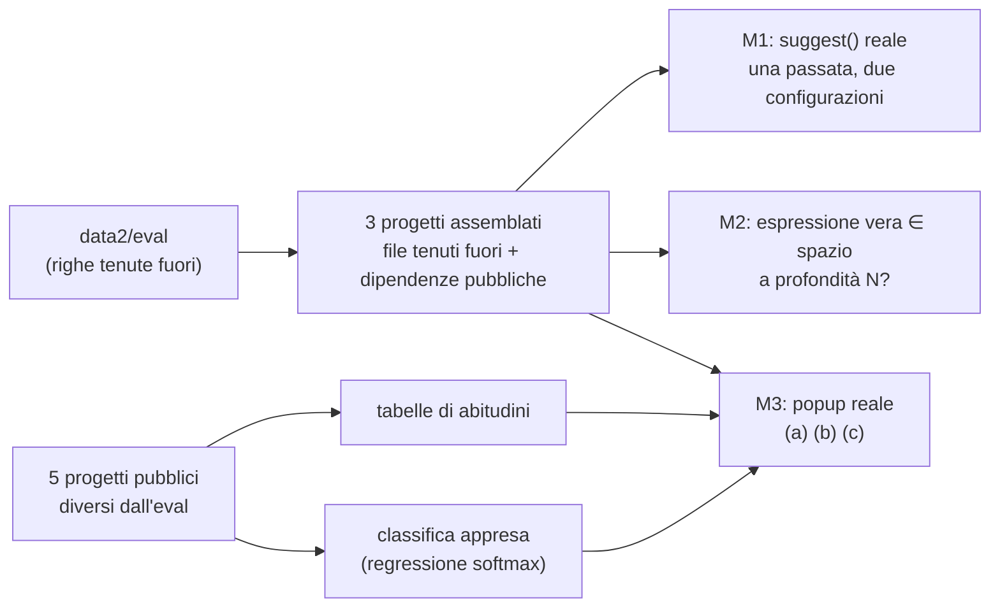
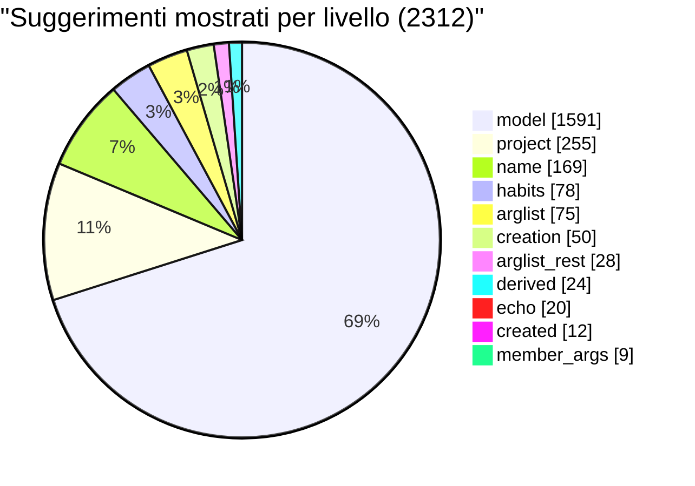

# Banco di prova ML di Bennu: cascata, sintesi guidata dai tipi, classifica appresa

> Tre misure offline, su codice **solo pubblico**, per decidere se spostare l'investimento dal modello del ghost text a un completamento guidato dai tipi con ordinamento appreso in-project. Ogni misura è un test ignorato che si lancia con un comando; i numeri qui sotto sono quelli di quella corsa.

## In breve

| misura | domanda | risposta in una riga |
|---|---|---|
| **M1** ablazione della cascata | quanto vale il modello ONNX dentro la cascata? | senza modello si mostra il 23% delle righe con il 25% di esatte; col modello il 73% con il 32%. Le righe esatte passano da 180 a 742: **il modello ne scrive il 76%** |
| **M2** copertura della sintesi | quanto di ciò che si scrive è ricostruibile con ≤ 2 passi dall'indice? | 59% a profondità ≤ 2 (rigoroso), 53% a ≤ 1: ma il 23% è già una semplice variabile e il 20% un letterale |
| **M3** classifica appresa | l'ordine del popup si migliora con tabelle o con un modello? | sugli argomenti **+9,9 punti** di primo posto (51,5% → 61,4%); sui membri +3 punti; le tabelle prefillate da altri progetti **non aiutano** |



## Come si riproduce

I risultati finiscono in `bennu-flc/ml_bench/work/results/` (fuori dal repo). Prima corsa: l'assemblaggio dei progetti e l'indicizzazione richiedono qualche minuto. I test sono in `crates/products/bennu/runtime/be/src/mlbench/`, compilati solo sotto `cfg(test)`.

```bash
cargo test -p bennu-be mlbench::m1_cascade -- --ignored --nocapture
```

```bash
cargo test -p bennu-be mlbench::m2_synth -- --ignored --nocapture
```

```bash
cargo test -p bennu-be mlbench::m3_rank -- --ignored --nocapture
```

Variabili: `BENNU_MLB_LAB` (cartella del lab), `BENNU_FLC_MODEL` (default `data8`), `BENNU_MLB_N` (campioni), `BENNU_MLB_ONLY=<progetto>`, `BENNU_MLB_MIN` (soglia della cascata, 70), `BENNU_MLB_TRAIN=a,b` (progetti di addestramento di M3).

## Cache dei progetti e dell'indice

I progetti assemblati e i loro indici sono persistiti sotto `bennu-flc/ml_bench/work/` e riaperti alla corsa successiva:

- **Progetti assemblati** (`work/projects/…`): la chiave è l'hash di versione del crate, versione del layout, **contenuto** dei file tenuti fuori e, per le dipendenze, elenco e dimensioni dei file. Se la chiave coincide il progetto non si ricopia; il marcatore `.assembled` si scrive a copia finita, quindi una copia interrotta si rifà.
- **Indici** (`work/cache/home/…`): Bennu persiste già `symbols.blob`, `names.fst` e il giro dei riferimenti sotto la sua cartella dati, per radice del progetto. Il banco punta `HOME` a `work/cache/home` (`BENNU_MLB_REAL_HOME=1` lo lascia com'è), così gli indici stanno nella cache, riaperti dalla corsa dopo e **fuori dal profilo vero** di Arbor. La validità dell'indice la decide Bennu (versioni dello schema, stampe dei file).
- **`BENNU_MLB_REBUILD=1`** cancella progetti e indici e ricostruisce tutto. `BENNU_MLB_TAG=<x>` prefissa i file dei risultati.
- **`mlbench::cache_check::the_cache_changes_no_number`** lancia M1 (80 righe) e M3 (60 siti, senza addestramento) due volte in processi figli, una con la ricostruzione e una riaprendo la cache, e verifica che le righe di M1 e il rapporto di M3 siano **byte per byte identici** (verificato).

Tempi in profilo debug (millisecondi; la riga «solo parsing» è il pavimento di qualunque indice: ogni sorgente analizzata una volta con tree-sitter):

| progetto (file) | assemblaggio freddo / riuso | solo parsing | indice simboli freddo / caldo | motore semantico freddo / caldo | totale freddo | totale caldo |
|---|---|---|---|---|---|---|
| commons-lang (611) | 140 / 59 | 1106 | 3734 / 3818 | 24 479 / 550 | **28,4 s** | **4,4 s** |
| commons-text (475) | 89 / 19 | 574 | 1540 / 1638 | 8199 / 220 | **9,8 s** | **1,9 s** |
| spring-reactive (3926) | 610 / 54 | 3106 | 8225 / 8301 | 57 590 / 1965 | **66,4 s** | **10,3 s** |

Dove va il tempo di una corsa fredda: l'**assemblaggio è meno dell'1%**; il **giro dei riferimenti del motore semantico è l'86-87%** (la parte cacheata: 24,5 s → 0,55 s); l'**indice dei simboli è il 13%** e **non** è cacheato (Bennu lo ricostruisce a ogni apertura: 3,7 s su Commons Lang, 8,3 s sui 3926 file di Spring), di cui il parsing puro è circa un terzo (1,1 s su 3,7). Il tempo lungo della corsa fredda è quindi l'inferenza di riferimenti, non l'analisi dei file.

> [!NOTE] Profilo release non misurato
> I test in release richiedono di compilare in release l'intero grafo di Bennu (LTO sottile): non è stato fatto. I numeri sopra sono quelli del profilo di test (debug), da leggere come ordine di grandezza.

## Apertura a freddo: dove va il tempo davvero (profilo release)

Misure in **release** (compilata senza LTO, 16 unità di codegen, in una cartella di build a parte) sulla stessa cache dei progetti; millisecondi. Tutte con la configurazione di fabbrica, in cui `index_threads = 1`: **gli sweep in background sono seriali per scelta** (il commento in `config.rs` spiega: «cores − 2» bloccava l'editor).

| progetto (file) | assemblaggio | solo parsing | indice simboli (freddo = caldo) | giro dei riferimenti freddo | giro dei riferimenti caldo | totale freddo | totale caldo |
|---|---|---|---|---|---|---|---|
| commons-text (475) | 99 | 215 | 550 | 1967 | 0 | **2,6 s** | **0,6 s** |
| commons-lang (611) | 31 | 363 | 1099 / 1076 | 5478 | 110 | **6,6 s** | **1,2 s** |
| spring-reactive (3926) | 41 | 960 | 2412 | 14 509 | 433 | **17,0 s** | **2,9 s** |

Rispetto al debug (28,4 s / 9,8 s / 66,4 s) la release è 3,8–4,3 volte più veloce; le proporzioni non cambiano: il giro dei riferimenti è l'80-85% del freddo, l'indice dei simboli il 14-17% (e lo stesso a caldo: non è cacheato).

### Cosa fa il giro dei riferimenti

- **Quanto lavoro:** Commons Lang 611 file → 151 212 tentativi di risoluzione (247 per file), 96,8% risolti; Spring 3926 file → 405 382 tentativi (103 per file), 88,8% risolti. In serie sono **36 µs per tentativo** in tutti e due i progetti: il costo è lineare nel numero di riferimenti, non nei file.
- **Dove va la CPU** (campionamento di 9 s di una apertura fredda di Commons Lang, release, 1 ms): attraversamento dell'albero di tree-sitter (`ts_node_child_iterator_next`, `…child_with_descendant`, cursori) **36%** della CPU in uso; allocazioni 8%; conversioni UTF-8 4,6%; e, **37,5%, `dep_record::fnv1a`**: l'hash FNV, byte per byte, dell'intero `members_json` di un tipo, ricalcolato a ogni `dep_signature` (la controlla lo sweep di validazione che parte subito dopo l'indice: `whole_file → type_access_errors_in → members_of → dep_signature`). Non è nel tempo del giro dei riferimenti ma gli ruba CPU.
- **Parallelismo:** il giro è un `parallel_map` a coda condivisa (i risultati tornano in ordine). Variando `index_threads`:

| lavoratori | Commons Lang: giro | accelerazione | Spring: giro | accelerazione | Commons Lang: indice simboli | Spring: indice simboli |
|---|---|---|---|---|---|---|
| 1 (fabbrica) | 5556 | 1,0× | 14 237 | 1,0× | 981 | 2397 |
| 2 | 3612 | 1,5× | 10 046 | 1,4× | 649 | 1753 |
| 4 | 2408 | 2,3× | 8214 | 1,7× | 429 | 1281 |
| 8 | 2187 | 2,5× | 7684 | 1,9× | 439 | 1086 |
| 16 (auto, 18 core − 2) | 2270 | 2,4× | 7645 | 1,9× | 440 | 973 |

  La scala **si ferma a 4-8 lavoratori**. Il campionamento di una corsa a 16 lavoratori su Spring spiega perché: `__psynch_mutexwait` è 41 463 campioni, quasi tutti nello stesso punto, il `Mutex<Inner>` di `JdkMemberIndex` (`bennu_query::jdk`). `members_of` lo prende **anche per un colpo nella memoria** e clona l'intero `ClassMembers` (non un `Arc`) tenendo il lucchetto: ogni risoluzione di un tipo JDK nel giro (`String`, `List`, ...) passa da lì uno alla volta.

### Ottimizzazioni, nell'ordine chiesto

| # | proposta | guadagno stimato | rischio | stesso numero di riferimenti? |
|---|---|---|---|---|
| 1 | **Cache a grana più fine.** Esiste già: per ogni file l'hash del contenuto, e si rifanno solo i file cambiati e quelli che citano un tipo cambiato (l'apertura calda lo prova: 0,1–0,4 s). Il buco è la guardia globale `type_map_hash`: aggiungere o togliere **un solo tipo** getta via tutta la cache. Sostituirla con l'invalidazione per nome (i file che hanno cercato quel nome semplice, anche senza trovarlo) | dopo l'aggiunta di un file: da giro intero (5-15 s) a < 1 s | medio-alto: si devono registrare le ricerche andate a vuoto, i `import …*` e i nomi sullo stesso pacchetto, o si perdono riferimenti | sì, se le dipendenze registrate sono complete: lo si verifica con un test «giro completo = giro incrementale» sul numero di riferimenti |
| 2 | **Parallelismo.** Prima togliere il lucchetto (punto A sotto); poi alzare il default da 1 a 4 con priorità bassa del sistema (QoS «utility» su macOS) invece di serializzare | a 4 lavoratori con A: giro di Commons Lang ≈ 5,5 → 1,5 s, Spring ≈ 14 → 4-5 s (stima: oggi 2,3× e 1,7×; il lucchetto è la causa del tetto) | basso per il codice; medio per l'editor se il default sale | sì: l'ordine dei risultati è ripristinato dall'indice |
| 3 | **Indice dei simboli persistito.** `symbols.blob` e `names.fst` sono già scritti, ma a ogni apertura si rilegge e rianalizza ogni sorgente. Convalidarli per stampa di file (mtime+dimensione, come fa il giro dei riferimenti) e ricostruire solo i file cambiati (`refresh_file` esiste) | caldo: 1,1 s → ~0,1 s su Commons Lang, 2,4 s → ~0,2 s su Spring (il 40-80% dell'apertura calda) | medio: l'indice dei simboli alimenta tutto; un errore di invalidazione è un completamento che manca | sì, per costruzione, se la stampa dei file è completa |
| 4 | **Risoluzione pigra.** Il giro non è necessario per il completamento, solo per cerca-usi/rinomina: dichiarare «navigazione pronta» dopo l'indice dei simboli e fare il giro in coda, o file per file alla prima richiesta | tempo al primo utile: 6,6 s → 1,1 s (Commons Lang) | alto: un rinomina o «elimina in sicurezza» fatto a giro incompleto non deve fidarsi; il risultato resta identico solo a giro completo | sì a giro completo; no prima |

**A. Lucchetto di `JdkMemberIndex` (nuova, non nella tua lista).** Sostituire `Mutex<Inner>` con `RwLock` (lettura per i colpi) e memoria di `Arc<ClassMembers>`; il lucchetto di scrittura solo per le mancate. Guadagno: toglie la causa del tetto a 2,5× (vedi punto 2); costo: nessuno per chi legge. Stesso risultato per costruzione.

**B. Memoria di `dep_signature` (nuova).** Calcolare l'hash una volta per tipo e invalidarlo quando cambia lo strato di sovrascrittura. Guadagno: ≈ 35% della CPU nei primi secondi dell'apertura fredda (lo sweep di validazione), nessuna differenza di risultati (l'hash è lo stesso).

**C. Dentro il giro.** Il 36% della CPU è navigazione dell'albero, con molti `Vec` allocati da `named_children()`: sostituirli con un cursore (`TreeCursor`) dovrebbe valere un 10-20% in serie; stesso risultato.

> [!NOTE] Un'ipotesi che ho provato e scartato
> Il campionamento a 1 ms mostra `fnv1a` primo tra le funzioni. Ho provato a togliere l'hash dal percorso del giro (`project_contains` chiamava `dep_signature` solo per sapere se il tipo esiste): **nessun guadagno** (5,51 s contro 5,93 s di giro su Commons Lang, nel rumore). L'hash caldo è quello dello sweep di validazione, non del giro. La modifica era di una riga in `resolver.rs`, tenuta per i pochi minuti di una compilazione e rimessa com'era; il file coincide con `HEAD`.

> [!WARNING] Cosa non è stato misurato
> La build release senza LTO non è quella spedita (LTO sottile, 1 unità): i valori assoluti possono scendere di un altro 10-20%. Lo sweep di validazione non ha un tempo suo nel banco: il suo costo è stimato dal campione di CPU. Le accelerazioni «stimate» (righe 1-4, A-C) sono ragionate sul campionamento, non provate applicando la modifica, tranne l'ipotesi scartata.

### Implementato: meno attese sull'indice del JDK (`bennu-query`, `jdk.rs`)

Il campionamento a 16 lavoratori mostrava tutti i thread in coda su un solo `Mutex` dell'indice dei membri del JDK. Cambiato **un pezzo alla volta**, misurato in release, con prova di identità (stesso totale di riferimenti e stessa risposta di «trova usi» su 400 posizioni per progetto: Commons Lang 399 risposte e 41 885 usi, Spring 380 e 20 100, hash dei risultati ordinati identico prima e dopo, a freddo e a caldo, con 1, 4 e 16 lavoratori):

| passo | giro dei riferimenti a freddo | tenuto? |
|---|---|---|
| 1. memoria dei membri dietro `RwLock` (i colpi non fanno più coda) | ≤ 7% | no da solo, ma serve al passo 3 |
| 2. + memoria di `package_exists` e di `class_annotations` | ≤ 5% | `package_exists` sì, `class_annotations` no (nessun guadagno) |
| 3. + **un tipo in un pacchetto che il JDK non ha è una mancata risposta senza cercarlo nell'immagine** | **fino a 2,0×** | **sì: è questo il guadagno** |

I tipi delle librerie del progetto (Spring, Reactor) non stanno nel JDK; ogni nome distinto veniva cercato nell'immagine tenendo il lucchetto, in coda con gli altri thread. Ora si chiede prima il pacchetto (ricordato per la sessione): se il JDK non ce l'ha la classe non c'è. Il risultato è lo stesso per costruzione (`Some(false)` vuol dire nessuna classe nel pacchetto né sotto); `None` («non so») cerca come prima.

Apertura **a freddo del progetto** (indice del progetto dimenticato; la memoria del JDK, condivisa fra i progetti e persistente, calda come nell'uso di ogni giorno), giro dei riferimenti in millisecondi, release:

| progetto | lavoratori | prima | dopo | accelerazione |
|---|---|---|---|---|
| commons-lang | 1 (fabbrica) | 5578 | 4729 | 1,18× |
| commons-lang | 4 | 2405 | 1754 | 1,37× |
| commons-lang | 16 | 2167 | 1739 | 1,25× |
| spring-reactive | 1 (fabbrica) | 14 625 | 10 837 | 1,35× |
| spring-reactive | 4 | 7958 | 3700 | **2,15×** |
| spring-reactive | 16 | 7846 | 4021 | 1,95× |

A caldo non cambia nulla (0,1–0,4 s): non passa dal JDK. Apertura completa a freddo di fabbrica (indice dei simboli + riferimenti): Commons Lang 6,6 → 5,7 s, Spring 17,0 → 13,3 s; con 4 lavoratori Commons Lang 2,9 → 2,2 s e Spring 9,3 → 5,0 s. File toccati: `analysis/query/src/jdk.rs` (e un test, `a_class_in_a_package_the_jdk_lacks_is_a_miss_without_a_lookup`); il resto è del banco. I test di `bennu-query` (220) passano; quelli di `bennu-be` e `bennu-intel` falliscono solo dove già fallivano (build_queue, tree_watch, add_parameter, postfix).

> [!NOTE] «A freddo» in questo rapporto contiene due cose diverse
> Le tabelle di sopra (28,4 s in debug, 6,6 s in release) cancellavano **anche** la memoria del JDK, che invece è persistente e condivisa fra i progetti: sono il caso di un primo avvio assoluto. L'apertura a freddo di un **progetto nuovo** in uso normale è quella di questa sezione (`BENNU_MLB_COLD_PROJECT=1` del banco).

**Non fatto**, nell'ordine in cui conviene: *memoria di `dep_signature`* (≈ 35% della CPU dello sweep di validazione, non cambia i tempi dell'apertura); *indice dei simboli persistito* (1,1–2,4 s a ogni apertura, anche a caldo: medio rischio, da fare per primo se serve scendere sotto il secondo a caldo); *guardia dei tipi per nome* (rischio alto, vedi sopra); *default di `index_threads`* (da 1 a 4: sale l'uso di CPU in background, è una scelta di prodotto, non l'ho cambiata).

## M4 completo: riempire e controllare; `flc_body`; il giro con le librerie

**Riempimento** (`mlbench/m4_fill.rs`). Per 600 metodi tenuti fuori (200 per progetto) si prendono i cinque metodi più simili con lo stesso numero di parametri e se ne adatta il corpo: i parametri per posizione, la proprietà derivata dal nome (`getX` → `x`; `this.x` incluso), gli altri nomi liberi dall'elenco di parametri e campi della classe, nell'ordine che dà il ranker di `flc_rank` per quel nome. Il primo candidato che non aggiunge errori a quelli che il corpo vero aveva già (il controllo di Bennu su tutto il file) vince.

| classe | metodi | produce qualcosa | compila | esatto | esatto di forma | esatto in uno dei cinque | righe esatte per metodo |
|---|---|---|---|---|---|---|---|
| setter | 7 | 100% | 100% | 57,1% | 57,1% | 57,1% | 0,57 su 1,00 |
| getter | 25 | 100% | 88,0% | 44,0% | 48,0% | 44,0% | 0,44 su 1,00 |
| delega | 37 | 100% | 70,3% | 21,6% | 37,8% | 21,6% | 0,22 su 1,00 |
| CRUD | 63 | 100% | 77,8% | 14,3% | 25,4% | 14,3% | 0,48 su 2,05 |
| validazione | 10 | 100% | 80,0% | 10,0% | 10,0% | 10,0% | 0,20 su 1,90 |
| altro | 431 | 99,8% | 76,6% | 9,3% | 21,8% | 9,3% | 0,68 su 2,90 |
| conversione | 27 | 100% | 59,3% | 7,4% | 11,1% | 7,4% | 0,48 su 2,22 |
| **tutti** | 600 | 99,8% | 76,3% | 12,5% | 24,0% | 12,5% | 0,60 su 2,55 |

«Compila» è un controllo debole per costruzione: i metodi del campione sono spesso test che chiamano librerie senza sorgenti, e il criterio «nessun errore in più di quelli già presenti» lascia passare molto. Provare i cinque candidati non aggiunge nulla all'esatto (la colonna «in uno dei cinque» coincide con «esatto»): il candidato giusto è il primo che compila, quando c'è. Il riempimento con l'enumeratore di M2 non è stato costruito a parte: i nomi liberi sono riempiti dal ranker sui soli parametri e campi della classe.

**`flc_body.rs`.** Dove il recupero rende (setter e getter) il corpo si scrive meglio dal campo: nome e tipo che combaciano, lo stile (`this.x` o `x`) dagli altri accessor del file o, in mancanza, dalle altre classi del file; tace senza campo, con un campo `static`, di tipo diverso o array. Su tutti i `getX`/`setX` tenuti fuori (2882, anche quelli che non sono accessori): propone per il 23,6% dei getter (74,2% esatti) e per il 51,1% dei setter (78,7% esatti); gli errori sono quasi tutti di stile quando il file non ha un altro accessor da imitare. Test unitari: 6. Non è agganciato a `flc.rs`.

**Il giro dei riferimenti con le librerie.** Vedi il riepilogo, sezione 7: +5,6% di riferimenti risolti su jackson-databind e 51 posizioni di «trova usi» in più, ma una posizione perde 18 usi (il nome di una classe del progetto si risolve sulla stessa classe di un jar di un'altra versione) e la cache dei riferimenti non è legata ai jar. `BENNU_RENAME_FULL_RESOLVER=1` oggi non ha effetto pratico perché il giro parte prima che le librerie siano pronte (con una attesa di 1,2 s nel banco ha funzionato). Non adottato; `index_service.rs` è com'era.

## Dati

- **Righe tenute fuori:** `data2/eval` (1385 file: Commons Lang 611, Commons Text 211, Spring WebFlux 439, R2DBC 88, tutorials 36). I file **non** sono quelli di `corpus/` (versioni diverse: nessuno coincide byte per byte con commons-lang), quindi ogni progetto da indicizzare è assemblato così: file tenuti fuori + sorgenti pubblici delle librerie da cui dipendono (commons-text vede commons-lang; spring/reactive vede spring-core, beans, context, web, tx, jdbc e reactor-core).
- **Modello:** `data8`, la cui `SOURCES.txt` elenca solo repository pubblici. `data2` è un modello a byte più vecchio e la sua cartella non ha il vocabolario.
- **Addestramento di M3:** commons-io, commons-collections, mockito, junit5, jackson-databind. Mai commons-lang/text, spring-framework o tutorials: sono lo stesso software dell'eval in un'altra versione.
- Niente di privato è stato aperto; niente rete; nessuna libreria nuova (la regressione è scritta a mano).

## M1 — ablazione della cascata (3170 righe)

Il modello è l'**ultimo** livello di `suggest_from_layers`: «cascata senza modello» sono esattamente i campioni a cui non ha risposto lui, quindi una sola passata di `suggest` risponde a entrambe le configurazioni. `name` sta dentro il ramo del modello e nel prodotto sparisce con lui, perciò è contato a parte. Sottolivelli di `habit` e `arguments` sono riconosciuti richiamando i livelli nell'ordine della cascata. I numeri sono quelli della corsa con `HOME` isolato (vedi sotto).

> [!CAUTION] Le prime corse usavano il profilo vero di Christian
> Una prima versione di questa tabella (825 risposte del modello, 48% di copertura) fu misurata con `HOME` reale: la calibrazione della confidenza (`calibrated`) legge le statistiche d'uso accumulate nel profilo, e restringeva la fetta del modello. Con il profilo isolato (`work/cache/home`, impostazioni e statistiche vuote) a parità di campioni la fetta del modello è di 1591 risposte; su 150 righe di Commons Text 69 con profilo isolato contro 23 con quello vero. Nessun codice dell'utente era coinvolto, ma sono numeri che dipendevano dal suo uso: **da qui in poi vale solo la corsa isolata**. M3 (popup, addestramento e pesi) è stato rilanciato per intero con il profilo isolato e dà **le stesse cifre, pesi compresi**: l'ordine del popup non dipende dal profilo. Le sezioni M2 e «Perché il popup…» non sono state rilanciate isolate (non leggono la calibrazione).

| configurazione | mostrate | copertura | esatte | esatte sulle mostrate | prefisso sulle mostrate | prefisso sulle richieste | inventate | ripetute |
|---|---|---|---|---|---|---|---|---|
| cascata intera | 2312 | 72,9% | 742 | 32,1% ±1,9 | 47,3% | 34,5% | 1,8% | 5,2% |
| senza modello | 721 | 22,7% | 180 | 25,0% ±3,2 | 33,7% | 7,7% | 5,7% | 2,9% |
| senza modello e senza `name` | 552 | 17,4% | 180 | 32,6% ±3,9 | 43,1% | 7,5% | 7,1% | 3,8% |
| solo la fetta del modello | 1591 | 50,2% | 562 | 35,3% ±2,3 | 53,5% | 26,8% | 0,0% | 6,2% |
| modello da solo, ogni posizione, senza soglia | 2253 | 71,1% | 758 | 33,6% ±2,0 | 52,1% | 37,1% | n.m. | 5,3% |

**Controllo di coerenza:** il modello da solo dà 33,6% × 71,1% = 23,9% di righe esatte sul totale, contro il 24% di riferimento del lab.

### Chi risponde



| livello | mostrati | esatte | prefisso | inventate | ripetute |
|---|---|---|---|---|---|
| model | 1591 | 35,3% | 53,5% | 0,0% | 6,2% |
| project (righe uguali in più file) | 255 | 57,6% | 63,0% | 14,9% | 1,6% |
| name | 169 | 0,0% | 2,9% | 1,2% | 0,0% |
| habits | 78 | 0,0% | 11,1% | 0,0% | 0,0% |
| arglist | 75 | 26,7% | 48,9% | 0,0% | 0,0% |
| creation | 50 | 0,0% | 8,2% | 0,0% | 0,0% |
| arglist_rest | 28 | 35,7% | 57,3% | 3,6% | 0,0% |
| derived (blocchi che seguono dalla classe) | 24 | 0,0% | 0,0% | 0,0% | 70,8% |
| echo | 20 | 0,0% | 8,1% | 0,0% | 0,0% |
| created | 12 | 25,0% | 75,5% | 0,0% | 0,0% |
| member_args | 9 | 0,0% | 12,1% | 0,0% | 0,0% |
| array_ctor | 1 | 0,0% | 0,0% | 0,0% | 0,0% |

`similar`, `annotation`, `mapping`, `sequence`, `log` e `class_literal` non hanno risposto su nessuna delle 3170 righe: sono livelli pensati per idiomi (corpo di un metodo gemello, annotazioni, log) che il campione «dopo un inizio parola» incontra di rado. `derived` produce blocchi su più righe: confrontati con una riga sola «esatto» e prefisso non dicono nulla di loro.

### Il contributo marginale del modello, per la sua stessa confidenza

| modello con confidenza ≥ | risposte del modello | esatte | cascata combinata: mostrate | copertura | esatte sulle mostrate | prefisso sulle richieste |
|---|---|---|---|---|---|---|
| (senza modello) | 0 | — | 721 | 22,7% | 25,0% | 7,7% |
| 0,70 | 1591 | 35,3% | 2312 | 72,9% | 32,1% | 34,5% |
| 0,80 | 1251 | 42,0% | 1972 | 62,2% | 35,8% | 31,5% |
| 0,85 | 977 | 48,1% | 1698 | 53,6% | 38,3% | 27,9% |
| 0,90 | 647 | 57,5% | 1368 | 43,2% | 40,4% | 22,5% |
| 0,95 | 312 | 77,6% | 1033 | 32,6% | 40,9% | 16,1% |

Le righe esatte passano da 180 a 742: **il modello ne scrive il 76%** (562). A parità di precisione mostrata non è sostituibile dagli altri livelli: la sua fetta ≥ 0,95 (312 risposte) è esatta al 78% e porta la cascata da 25,0% a 40,9% di esatte sulle mostrate.

> [!WARNING] «Esatta» è il metro sbagliato per i livelli che scrivono un frammento
> `name` (il nome della variabile), `habits`, `creation`, `echo` e `member_args` suggeriscono un pezzo di riga, non la riga: per costruzione non sono mai «esatti» (0%). Per loro conta il **prefisso accettato**, e questo è basso, tra 3% e 12%. Insieme sono 326 dei 721 suggerimenti della cascata senza modello (45%): quasi metà del suo volume ha un valore misurabile minimo.

## La cascata di produzione di oggi (ranker, `ngram`, `catch`, `derived`)

Stesso M1 (3170 righe, profilo isolato) con la cascata attuale: livello `ngram` (copia a n-grammi del progetto: quota forte ≥ 0,7 **prima** del modello, debole dopo), `catch`, blocchi `derived`/`stubs`/`tests`. I livelli che copiano contano ogni riga del progetto dal disco, anche quella chiesta: il banco ricontà prima di ogni campione il file come buffer **senza** la riga (`flc_ngram::add_file`, `flc_catch::add_file`), come se non fosse ancora scritta. Il livello `catch` non ha risposto su nessuna delle 3170 righe.

| giro | mostrate | copertura | esatte | esatte sulle mostrate | prefisso sulle mostrate | prefisso sulle richieste |
|---|---|---|---|---|---|---|
| precedente (senza `ngram`) | 2312 | 72,9% | 742 | 32,1% | 47,3% | 34,5% |
| **produzione** (`ngram` forte prima del modello) | 2395 | 75,6% | 736 | 30,7% | 46,4% | 35,1% |
| controfattuale: `ngram` solo dopo il modello | 2395 | 75,6% | 759 | 31,7% | 46,9% | 35,4% |

| livello | mostrati | esatte | prefisso | inventate | confidenza media | giro precedente: mostrati / esatte / prefisso |
|---|---|---|---|---|---|---|
| model | 1419 | 34,6% | 52,7% | 0,0% | 0,87 | 1591 / 35,3% / 53,5% |
| **ngram** | 259 | 25,1% | 47,5% | 0,0% | 0,91 | — |
| project | 255 | 57,6% | 63,0% | 14,9% | 0,99 | 255 / 57,6% / 63,0% |
| name | 169 | 0,0% | 2,9% | 1,2% | 0,60 | 169 / 0,0% / 2,9% |
| arglist | 76 | 26,3% | 48,2% | 0,0% | 0,68 | 75 / 26,7% / 48,9% |
| habits | 72 | 0,0% | 9,6% | 0,0% | 0,83 | 78 / 0,0% / 11,1% |
| creation | 50 | 0,0% | 8,2% | 0,0% | 0,70 | 50 / 0,0% / 8,2% |
| arglist_rest | 29 | 34,5% | 55,4% | 3,4% | 0,73 | 28 / 35,7% / 57,3% |
| derived | 24 | 0,0% | 0,0% | 0,0% | 0,91 | 24 / 0,0% / 0,0% |
| echo | 20 | 0,0% | 8,1% | 0,0% | 0,60 | 20 / 0,0% / 8,1% |
| created | 12 | 25,0% | 75,5% | 0,0% | 0,89 | 12 / 25,0% / 75,5% |
| member_args | 9 | 0,0% | 12,1% | 0,0% | 0,84 | 9 / 0,0% / 12,1% |

### `ngram` ruba righe al modello?

Sì, e non rende abbastanza per pagarle. Delle 562 righe esatte del modello nel giro precedente, 491 restano al modello, **46 passano a `ngram` con una risposta sbagliata (righe perdute)** e 25 a `ngram` con la risposta giusta. Le righe esatte nuove sono 40 (36 dalla quota forte, 4 dalla debole). Saldo: **−46 + 40 = −6 righe esatte**; coperture +2,7 punti, prefisso sulle richieste +0,6.

| `ngram` | mostrati | esatte | prefisso | su righe a cui rispondeva il modello |
|---|---|---|---|---|
| forte (≥ 0,7), prima del modello | 241 | 25,3% | 49,1% | 175: il modello esatto 71, `ngram` esatto 48 (25 in comune) |
| debole (< 0,7), dopo il modello | 18 | 22,2% | 25,7% | 0 (per costruzione) |

Il livello prende le righe dove il modello tace e lì rende (84 righe, 17 esatte, prefisso 36%), ma prima del modello **ha una precisione (25,3%) più bassa di quella del modello (34,6%)**. Messo solo dopo il modello il saldo sarebbe +17 righe esatte (759, controfattuale in tabella).

> [!IMPORTANT] La confidenza di `ngram` era giusta; era il metro a ingannare (correzione)
> Nelle versioni precedenti di questa sezione la confidenza di `ngram` sembrava non calibrata: le 183 righe in cui il livello di produzione dà una fiducia alta e la copia fuori linea no erano esatte solo al 4,9%. Quelle righe sono suggerimenti **parziali** (`agreed_start`: le parole su cui concorda almeno il 70% delle righe viste, in media 13,9 caratteri contro 27,7 attesi) giudicati sulla riga intera. **Giusto fin dove scrive** (il testo mostrato è l'inizio esatto della riga vera): 65,2% su quelle 183, 75,0% sulle 76 in cui concorda con M5, 68,1% in tutto contro il 37,7% del modello. Per fascia di fiducia: 0,5–0,7 → 22%; 0,7–0,9 → 59%; 0,9–0,999 → 72%; ≥ 0,999 → 76%. Verifica dell'ipotesi della riga contata da sola: con la riga interrogata nei conteggi `ngram` risponde meno (111 volte invece di 260: la sua presenza diluisce la quota), non di più; il banco la toglie come nell'editor. Nessuna correzione a `flc_ngram.rs` è risultata giustificata.
>
> **Sul furto di righe al modello**: sulle 175 righe in cui `ngram` risponde al posto del modello, `ngram` è giusto fin dove scrive in 132 (75%) e il modello è giusto in riga intera in 71 (41%); 79 righe sono a favore di `ngram`, 18 del modello. In totale le righe giuste fin dove scrivono passano da 842 a 945 e i caratteri sbagliati mostrati da 32 757 a 32 286. La conclusione «saldo −6 righe esatte, metterlo dopo il modello» dipendeva dal contare solo le righe intere ed è ritirata.

Un'altra cosa che M5 mostra: le righe su cui la copia fuori linea è esatta con quota ≥ 0,7 erano già risposte da altri livelli nella cascata: `project` 81 (76 esatte), `ngram` 76, modello 67, altri 38 e **20 silenzio**. Il guadagno netto di una copia in testa al modello si misura sul resto, e il resto è piccolo.

### Pulizia dei livelli deboli

Per ogni livello: fasce di confidenza e la soglia sotto cui il prefisso accettato è < 15%.

| livello | fasce (prefisso) | soglia | proposta |
|---|---|---|---|
| **name** (169) | 1,4 / 3,2 / 2,9 / 4,2%, **confidenza costante 0,60** | nessuna: nessuna fascia arriva al 15% | **spegnere** |
| **habits** (72) | 14,2 / 8,1 / 9,8 / 6,2% | nessuna soglia raggiunge il 15% di prefisso, ma il testo mostrato è giusto fin dove scrive nel 39,7% dei casi | **lasciare** (rivisto: il prefisso penalizzava i suggerimenti corti) |
| **creation** (50) | 20,5 / 0,0 / 3,9 / 9,0%, confidenza costante 0,70 | nessuna | **spegnere** |
| **echo** (20) | 1,7 / 3,3 / 27,5 / 0,0%, costante 0,60 | nessuna (campione piccolo) | **spegnere** |
| **member_args** (9) | 20,8 / 17,5 / 13,1 / 2,1% | campione troppo piccolo per una soglia | lasciare, rimisurare con più righe |
| **derived** (24) | 0 / 0 / 0 / 0% | metrica cieca: blocchi su più righe contro una riga attesa | lasciare, misurare a livello di blocco |
| **arglist** (76) | 36,8 / 16,3 / 59,2 / 80,6% | tutte le fasce ≥ 15% | **lasciare**; sopra 0,70 il prefisso è 70% e le esatte 45% |
| **arglist_rest** (29) | 50,5 / 17,5 / 68,3 / 81,5% | tutte ≥ 15% | lasciare |
| **created** (12) | 62–91% | — | lasciare |
| **project** (255) | esatte 57,6% | — | lasciare, ma 14,9% di righe «inventate» da guardare |

Spegnere **name, habits, creation, echo** (e, se si vuole, member_args) toglie 320 suggerimenti su 2395 (13%) che valgono lo 0% di righe esatte e il 2–10% di prefisso. Controfattuale a parità di tutto il resto (con `ngram` solo dopo il modello e **senza** altri suggerimenti al loro posto): mostrate 2075 (65,5%), esatte 759 (**36,6%** sulle mostrate, contro 31,7%), prefisso sulle mostrate 53,2% (contro 46,9%), prefisso sulle richieste 34,9% (contro 35,4%: il guadagno di prefisso di quei livelli vale 0,5 punti).

| configurazione | mostrate | copertura | esatte | esatte sulle mostrate | prefisso sulle mostrate | prefisso sulle richieste |
|---|---|---|---|---|---|---|
| produzione di oggi | 2395 | 75,6% | 736 | 30,7% | 46,4% | 35,1% |
| `ngram` solo dopo il modello | 2395 | 75,6% | 759 | 31,7% | 46,9% | 35,4% |
| e senza name, habits, creation, echo, member_args | 2075 | 65,5% | 759 | 36,6% | 53,2% | 34,9% |

> [!NOTE] Cosa non si sa
> Il controfattuale lascia vuoti i posti dei livelli spenti. Nel prodotto, spegnere `habits`/`creation`/`echo` lascerebbe passare il modello (che ha il 33,6% di esatte in tutte le posizioni senza soglia); `name` invece vive dentro il ramo del modello e spegnerlo restituisce il posto al modello solo se il livello dopo risponde. Non è stato rilanciato M1 con quei livelli spenti perché richiede di cambiare `flc.rs`.

## M2 — copertura della sintesi guidata dai tipi (5400 posizioni)

Non è il sintetizzatore: è il suo **tetto**. Per l'espressione che c'è davvero a destra si chiede se sta nello spazio di un enumeratore di profondità N, cioè se ogni chiamata, costruttore e campo è tipizzato dall'indice, ogni foglia è un nome in scope (o un letterale banale) e l'albero non è più profondo di N. Il tipo atteso non serve da filtro perché la verità è type-correct per costruzione. Profondità: variabile = 0, `v.m()` = 1, `f(v.m())` = 2. «Rigoroso» = nessun letterale libero; «+ letterali» = ogni letterale vale come buco che l'enumeratore riempie.

| posizione | campioni | profondità 0 | ≤ 1 | ≤ 2 | ≤ 3 (rig.) | non tipizzabile | non è composizione |
|---|---|---|---|---|---|---|---|
| dopo `=` | 1800 | 16,4% / 24,1% | 47,1% / 64,5% | **53,7%** / 73,3% | 54,9% | 10% | 14% |
| dopo `return` | 1800 | 38,4% / 39,6% | 62,0% / 63,9% | **71,6%** / 74,1% | 73,7% | 6% | 18% |
| argomento di chiamata | 1800 | 36,9% / 62,5% | 51,3% / 82,1% | **52,4%** / 83,8% | 52,9% | 3% | 12% |
| **tutte e tre** | 5400 | 30,6% / 42,1% | 53,5% / 70,1% | **59,2%** / 77,1% | 60,5% | 6% | 15% |

(per ogni cella: rigoroso / con letterali come buchi; le ultime due colonne sono le cause delle mancate coperture)

### Per forma della destra (tutte le posizioni)

| forma | quota | quota nel campione di riferimento | copertura rigorosa ≤ 2 (dopo `=`) | dopo `return` | argomento |
|---|---|---|---|---|---|
| variabile / campo | 23,3% | 26% | 99,4% | 96,8% | 98,6% |
| letterale | 20,3% | 10% | 49,1% | 89,5% | 27,6% |
| `valore.metodo(...)` | 16,1% | — | 55,5% | 63,5% | 56,2% |
| altro (operatori, ternari, array) | 11,0% | — | 11,7% | 12,2% | 20,5% |
| `Tipo.metodo(...)` | 9,7% | 25% | 44,9% | 64,0% | 32,2% |
| `new Tipo(...)` | 9,4% | 19% | 63,8% | 72,2% | 65,0% |
| chiamata della propria classe | 8,2% | 11% | 54,1% | 78,0% | 57,1% |
| lambda / riferimento a metodo | 2,0% | 2% | 0% | 0% | 0% |

La mia distribuzione differisce da quella del campione di riferimento: qui pesano di più i letterali (un terzo degli argomenti) e di meno `Tipo.metodo(...)` e `new`, perché Commons Lang è fatto di metodi statici di utilità e di variabili locali, non di factory.

> [!IMPORTANT] Copertura non è precisione
> Il 59% dice che la risposta giusta **è nello spazio**, non che un enumeratore la metta in cima. Non ho misurato la dimensione di quello spazio (candidati per sito a profondità 2): senza quel numero la copertura non decide nulla. Per le destre che sono già una variabile (23%) il problema è di classifica, non di sintesi: su 579 siti con tipo dichiarato noto, i locali e i parametri di quel tipo in scope sono in mediana 0 (la risposta è spesso un campo, che il conteggio non vede), al 90° percentile 2, esattamente uno nel 22%. Il guadagno vero della sintesi sta nelle forme chiamata/costruttore (circa il 43% dei siti: `valore.metodo`, `Tipo.metodo`, `new`, chiamata propria) e lì la copertura rigorosa a profondità 2 va dal 32% al 78% secondo la posizione.

## M3 — classifica appresa (1500 siti per posizione, ognuno a 0 e a 1 lettera battuta)

Il candidato giusto è primo / nei primi tre. Le etichette sono il codice già scritto: la vera chiamata o l'argomento vero sono il positivo, gli altri candidati **del popup reale** (`IndexService::completion`) i negativi. Per l'argomento si considerano solo i nomi semplici (variabile o campo), che sono il 31% degli argomenti. «Battuti 0» = cursore appena dopo il punto o la parentesi; «1» = una lettera già scritta.

- **(a)** l'ordine attuale del popup, con le abitudini in-project che esso già porta;
- **(b)** (a) con in testa ciò che le tabelle riempite dai 5 progetti pubblici hanno visto più spesso (tipo → membro, metodo → membro successivo nella catena, metodo/indice → argomento);
- **(c)** una regressione softmax scritta a mano (14 caratteristiche: rango nel popup, tipo di membro, frequenza e quota nelle tabelle, recenza nelle 60 righe sopra, somiglianza del nome col ricevitore o col parametro, coincidenza di tipo col parametro, lunghezza, deprecato), addestrata su 2518 siti di membro e 4888 di argomento, ognuno leggendo le tabelle **senza il proprio conteggio**.

| posizione | battuti | il vero è nel popup e il ricevitore è tipizzato | ordinamento | primo | primi 3 | MRR |
|---|---|---|---|---|---|---|
| membro dopo il punto | 0 | 50,8% | (a) popup | 20,0% ±2,0 | 30,8% | 0,273 |
| | | | (b) + tabelle | 14,7% ±1,8 | 29,3% | 0,238 |
| | | | **(c) appresa** | **23,2%** ±2,1 | **36,8%** | 0,313 |
| membro dopo il punto | 1 | 50,9% | (a) popup | 39,2% ±2,5 | 47,9% | 0,438 |
| | | | (b) + tabelle | 38,3% ±2,5 | 47,7% | 0,431 |
| | | | **(c) appresa** | **40,4%** ±2,5 | 48,6% | 0,445 |
| argomento (nome semplice) | 0 | 94,5% | (a) popup | 51,5% ±2,5 | 80,0% | 0,665 |
| | | | (b) + tabelle | 51,1% ±2,5 | 80,8% | 0,665 |
| | | | **(c) appresa** | **61,4%** ±2,5 | **83,3%** | 0,732 |
| argomento (nome semplice) | 1 | 96,4% | (a) popup | 82,8% ±1,9 | 95,9% | 0,886 |
| | | | (b) + tabelle | 82,7% ±1,9 | 95,9% | 0,885 |
| | | | **(c) appresa** | **83,9%** ±1,9 | 95,8% | 0,892 |

Le percentuali sono sui 1500 siti chiesti, compresi quelli in cui il popup non elenca affatto la risposta (per tutti quegli ordinamenti sono errori). Le tabelle (b) usano la soglia «almeno 1»; con «almeno 3» il risultato è lo stesso entro il rumore.

> [!CAUTION] Il «50,8%» non è il tetto del popup: è il tetto del mio banco
> La colonna «il vero è nel popup» conta solo i siti in cui `receiver_type_for` riesce a leggere il tipo del ricevitore (serve alle tabelle tipo → membro). Sono il 52% dei siti; **il popup elenca il membro vero nel 76,9%** (sezione sotto), anche in 391 siti in cui `receiver_type_for` non tipizza. I siti scartati contano come errori per tutti e quattro gli ordinamenti, quindi i confronti fra (a), (b) e (c) restano validi ma le percentuali assolute dei membri sono più basse del reale, e il «49% di popup che manca» scritto in una prima versione di questo rapporto era sbagliato. Sui siti con ricevitore tipizzato il primo posto passa da 39% (a) a 46% (c).

> [!NOTE] Le tabelle prefillate da altri progetti peggiorano i membri
> Le abitudini «tipo → membro» di commons-io, mockito & co. non si trasferiscono al codice di Commons Lang e Spring (membri −5 punti di primo posto a cursore appena dopo il punto): spostano in testa membri frequenti altrove. La classifica appresa le usa per i membri con un peso piccolo (0,14-0,22) e per i membri prende il guadagno da recenza e dal tipo di membro (campo/metodo); per gli argomenti da coincidenza di tipo col parametro, somiglianza col nome del parametro e quota nelle tabelle metodo → argomento.

## In produzione: il ranker degli argomenti

`flc_rank.rs` porta nel popup degli argomenti la regressione di (c), **senza le tabelle** (11 caratteristiche: rango del provider, tipo di riga, recenza nel file, somiglianza col nome del parametro, coincidenza di tipo col parametro, lunghezza, deprecato). I pesi sono una costante, adattati sui cinque progetti pubblici; si applica in `IndexService::completion` dopo le abitudini in-project, dietro lo stesso interruttore (`flc_feedback`), e riordina soltanto: una riga-abitudine in testa resta dov'è.

| argomento (nome semplice) | battuti | primo: popup | primo: ranker di produzione | primi 3: popup → produzione |
|---|---|---|---|---|
| 1500 siti | 0 | 51,5% ±2,5 | **63,5%** ±2,4 | 80,0% → 83,7% |
| 1500 siti | 1 | 82,8% ±1,9 | **83,9%** ±1,9 | 95,9% → 95,8% |

Senza le caratteristiche delle tabelle il guadagno è addirittura un po' maggiore che con esse (61,4% in M3): le tabelle metodo → argomento di altri progetti non servivano.

> [!WARNING] Misurare il ranker sul popup che lui stesso riordina dà numeri gonfiati
> Una prima corsa con il ranker già attivo nel popup dava «popup» 60,3% al posto di 51,5% (il popup era già riordinato) e pesi addestrati sul suo output. Il banco ora spegne il ranker durante la raccolta (`flc_rank::OFF`, solo nei test) e valuta quello di produzione sul popup grezzo.

## M4 — generare metodi interi: il tetto del recupero

Misurata soltanto la **metà di recupero** della catena «recupera → scheletro → riempi → compila». Per 2400 metodi tenuti fuori con 1–8 istruzioni (800 per progetto) si recuperano i più simili per sotto-parole del nome e tipi della firma (peso 2 e 1, similarità di Jaccard pesata) fra i metodi dei cinque progetti pubblici di addestramento e quelli dello stesso progetto; il metodo cercato non risponde mai a se stesso. Lo scheletro è la sequenza delle istruzioni con identificatori → `I` e letterali → `L`.

| classe | metodi | scheletro primo | scheletro nei primi 5 | scheletro nei primi 20 (**tetto**) | corpo identico primo | corpo identico nei primi 20 | righe identiche nel miglior risultato |
|---|---|---|---|---|---|---|---|
| getter | 106 | 53,8% | 77,4% | **88,7%** | 39,6% | 50,0% | 39,6% |
| setter | 37 | 43,2% | 83,8% | **94,6%** | 32,4% | 51,4% | 37,8% |
| delega | 124 | 31,5% | 57,3% | **66,1%** | 9,7% | 18,5% | 9,7% |
| CRUD | 265 | 21,1% | 36,6% | **43,4%** | 7,5% | 14,0% | 13,3% |
| conversione | 111 | 13,5% | 23,4% | **30,6%** | 6,3% | 11,7% | 19,7% |
| validazione | 69 | 18,8% | 33,3% | **37,7%** | 11,6% | 15,9% | 18,9% |
| altro | 1688 | 22,0% | 38,7% | **45,9%** | 7,2% | 16,4% | 22,1% |
| **tutti** | 2400 | 23,7% | 41,0% | **48,3%** | 9,2% | 18,0% | 21,3% |

> [!IMPORTANT] Cosa manca e perché le colonne richieste non ci sono
> Non sono stati costruiti il riempimento dei buchi con l'enumeratore di M2 ordinato dal ranker e il controllo di compilazione: non esistono quindi «produce qualcosa e compila», «esatto dopo il riempimento» né «righe esatte per metodo generato». Quel che c'è è il **tetto del recupero** (quote di scheletro e di corpo già nei primi k) e il baseline «copia la riga identica dal migliore». «Qualcosa recuperato» è il 100% e non dice nulla: l'indice restituisce sempre un vicino. Le classi sono euristiche sul nome e sulla forma (getter = `get/is/has` senza parametri e un `return` di nome; «altro» contiene i test di Commons Lang).

Lettura: con scheletro e sola copia i **getter e i setter** sono quasi risolti (89% e 95% di tetto, un corpo su tre identico al primo recuperato); la **delega** ha un tetto del 66% ma solo il 10% di corpi identici (serve riempire il buco); per **conversione e validazione** lo scheletro compare solo nel 31-38% dei casi, e per l'80% dei metodi la verità non è una copia di ciò che esiste: è la parte che un generatore dovrebbe davvero inventare.

## M5 — uno stack senza rete neurale al posto del modello

Il modello ONNX è sostituito da una **copia a n-grammi di token**: gli ultimi 5 (o 3) token prima del cursore → ciò che li ha seguiti, contato sulle righe dei cinque progetti pubblici di addestramento, sulle righe dei file tenuti fuori e sui sorgenti delle dipendenze del progetto; la riga interrogata è tolta dai conteggi. Si mostra solo con almeno 2 avvistamenti. Stessi 3170 campioni di M1; le risposte della cascata e del modello sono quelle di M1.

La fetta del modello in M1 (profilo isolato): 1591 risposte, 562 esatte (35,3%).

| confidenza n-grammi ≥ | mostrate | copertura | esatte sulle mostrate | prefisso sulle richieste | righe esatte del modello che riproduce | righe esatte che il modello non ha |
|---|---|---|---|---|---|---|
| 0,3 | 857 | 27,0% | 46,1% | 16,2% | 100 / 562 (17,8%) | 295 |
| 0,5 | 606 | 19,1% | 57,3% | 13,2% | 94 / 562 (16,7%) | 253 |
| 0,7 | 307 | 9,7% | 82,7% | 8,5% | 68 / 562 (12,1%) | 186 |
| 0,9 | 236 | 7,4% | 88,1% | 6,8% | 53 / 562 (9,4%) | 155 |

A parità di precisione col modello (35,3%) gli n-grammi la raggiungono già a 0,3 e riproducono il **17,8%** delle sue righe esatte; a precisione più alta ne riproducono meno. È lo stesso insieme di righe? No: sono in buona parte **altre** righe, copiate dal progetto, che il modello non indovina (295 contro 100).

| configurazione | mostrate | copertura | esatte | esatte sulle mostrate |
|---|---|---|---|---|
| cascata intera col modello | 2312 | 72,9% | 742 | 32,1% |
| solo livelli deterministici | 721 | 22,7% | 180 | 25,0% |
| deterministici + n-grammi ≥ 0,5 | 1121 | 35,4% | 390 | 34,8% |
| deterministici + n-grammi ≥ 0,7 | 895 | 28,2% | 319 | 35,6% |
| deterministici + n-grammi ≥ 0,9 | 856 | 27,0% | 296 | 34,6% |

Uno stack senza rete neurale (deterministici + n-grammi ≥ 0,5) scrive **390 delle 742 righe esatte (53%)** con metà della copertura, a precisione mostrata uguale o migliore (34,8% contro 32,1%).

Che tipo di righe restano al solo modello (tra le sue 562 esatte; soglia di parità 0,3):

| tipo di riga | esatte del modello | riprodotte dagli n-grammi | restano al modello |
|---|---|---|---|
| chiamata | 235 | 40 (17,0%) | 195 |
| altro (dichiarazioni, assegnazioni, ...) | 310 | 58 (18,7%) | 252 |
| lambda / riferimento a metodo | 14 | 2 (14,3%) | 12 |
| catena | 3 | 0 | 3 |

Di quelle esatte, 58 contengono una stringa letterale e 52 hanno 40 o più caratteri dopo il cursore: **non esiste un tipo di riga che resta al modello** e gli altri no; la quota riprodotta è bassa (14-19%) dappertutto, perché le righe esatte del modello sono per lo più quelle che il progetto non ha mai scritto uguali.

**(b) forma + riempimento.** Gli n-grammi astratti (identificatori → `I`, letterali → `L`) rispondono su 483 delle 562 righe esatte del modello e ne nominano la **forma giusta in 195 (34,7%)**. Il riempimento dei buchi (M2, ordinato dal ranker) non è stato costruito: 34,7% è un tetto di forma, non una pila misurata.

> [!WARNING] Limiti di M5
> Gli n-grammi vedono, per il progetto, anche le righe dei sorgenti delle **dipendenze** e degli altri file tenuti fuori: è «il progetto» come lo vede Bennu, ma per Commons Text include Commons Lang di una versione diversa da quella del campione. Nessun n-gramma dei file `data2/eval` entra nei conteggi dei progetti di addestramento. Il confronto «a parità di precisione» è con una fetta del modello poco selettiva (35,3% di esatte): contro la sua fetta ≥ 0,95 (77,6%) gli n-grammi pareggiano solo da ≥ 0,7 in su, dove riproducono il 12% delle sue righe.

## Perché il popup non elenca il membro vero (23,1% dei siti di membro)

Su 1500 siti (gli stessi di M3, cursore appena dopo il punto, il membro vero e la sua lista di argomenti tolti dal buffer) il popup elenca il membro nei primi 300 elementi in 1153 casi (**76,9%**); i 347 mancati sono classificati per causa. `receiver_type_for` tipizza il ricevitore in 781 siti (52,1%): la differenza sta in 391 siti in cui il popup funziona per un'altra strada.

> [!WARNING] La classificazione è un'euristica sul testo
> La causa è dedotta dalla forma del ricevitore e da cosa l'indice sa dire di esso (tipo del ricevitore, tipo dell'oggetto dell'ultima chiamata, risoluzione del nome del tipo dichiarato): non da una traccia dell'inferenza. «Correggibile» è un mio giudizio, **non verificato correggendo**.

| gruppo | causa | mancati | quota dei mancati | correggibile nell'inferenza? |
|---|---|---|---|---|
| catene | chiamata propria `foo().bar` che non tipizza | 50 | 14,4% | sì, probabile: il ritorno di un metodo della propria classe è nell'indice |
| catene | un anello precedente non tipizza | 30 | 8,6% | sì, per effetto a catena delle altre cause |
| catene | `T.m(...)` statico su tipo che si risolve, risultato non legato | 20 | 5,8% | sì: ritorno generico (`requireNonNull`, `expect`) da legare |
| catene | `new T(...)` con T noto, risultato non tipizzato | 19 | 5,5% | sì: `new T()` ha tipo T per costruzione, salvo T generico/anonimo |
| catene | ultima chiamata su tipo del progetto/libreria, risultato non legato | 17 | 4,9% | parziale: `getClass().getComponentType()` è un ritorno `Class<?>` |
| catene | ultima chiamata su tipo JDK, ritorno non legato | 1 | 0,3% | sì (generici/lambda) |
| `this` e campi | accesso `this.campo.membro` | 43 | 12,4% | da verificare: il campo è spesso di un tipo generico o di una libreria |
| `this` e campi | nome di campo/ereditato senza dichiarazione nel file | 25 | 7,2% | sì: serve la tabella dei campi ereditati |
| variabili | tipo dichiarato che si risolve, ma la variabile non tipizza | 37 | 10,7% | sì, probabile |
| variabili | accesso statico su tipo che si risolve | 34 | 9,8% | da indagare: non dovrebbe mancare nulla; ipotesi: il ricevitore sta su una riga precedente (`.unmodifiableList(`) o metodo/costante non visibile |
| variabili | parametro di lambda | 12 | 3,5% | sì: tipo funzionale atteso dal metodo che riceve la lambda |
| librerie | tipo dichiarato, accesso statico o `T.m()` su tipo di libreria senza sorgenti | 26 | 7,5% | **no, se la libreria non ha classi né sorgenti sul percorso**; sì con i jar/gli stub |
| tipizzato | il ricevitore è tipizzato ma il membro non è nelle tabelle o la tabella del tipo non è raggiungibile (conflitto di nome, tipo annidato, Kotlin) | 19 | 5,5% | in parte: il conflitto di nome sì; Kotlin e membri generati no |
| altro | `super.x`, `a[i].x`, ... | 14 | 4,0% | sì (`super`, array) |

Più grossolano: **le catene valgono il 40% dei mancati** (137), le variabili e le lambda il 24%, i campi/`this` il 20%, le librerie senza sorgenti il 7,5%, i tipizzati-ma-assenti il 5,5%.

### Esempi minimi (codice pubblico)

- *chiamata propria* — Commons Lang: `return wildcardType().withUpperBounds(unrolledUpperBounds).withLowerBounds(unrolledLowerBounds).build();` — dopo `wildcardType().`; Spring WebFlux: `return requestPath().pathWithinApplication().value();`.
- *`T.m()` statico* — Commons Lang: `Objects.requireNonNull(typeVariable, "typeVariable").getBounds()`; `EasyMock.expect(wrapped.newThread(r)).andReturn(t)`.
- *`new T(...)`* — Commons Lang: `new CompareToBuilder().append(null, obj1).toComparison()` — dopo `new CompareToBuilder().`.
- *`this`* — Spring WebFlux: `this.locationsToUse.isEmpty()`, `this.mappingRegistry.getRegistrations()`.
- *variabile* — Commons Lang: `map.firstEntry().getValue()` con `map` dichiarata (si risolve) e `firstEntry` assente; `things.get(2).string`.
- *lambda* — Spring WebFlux: `response.getHeaders().forEach(header -> responseHeaders.add(header.getName(), ...))` — dopo `header.`; `.filter(entry -> this.sessionAttributePredicate.test(entry.getKey()))`.
- *libreria senza sorgenti* — Commons Lang: `JavaVersion.JAVA_1_6.atLeast(...)`, `array.getClass().getComponentType()` su `Class` della libreria dichiarata.
- *tipizzato, membro assente* — Commons Text: `builder.fractionPlaceholder` (campo di un tipo annidato `DoubleFormat.Builder`); Spring: `this.port` (campo definito in una superclasse del test).

> [!NOTE] Cosa implica per il ghost text e per il ranker
> I mancati sono soprattutto problemi di **inferenza sulla catena** (due quinti), non di classifica: nessun ordinamento li recupera. Per il ghost text il modello e il controllo `flc_check` (che deve tipizzare la stessa catena per giudicare un'invenzione) soffrono delle stesse lacune: sono la stessa causa di fondo.

## I 347 mancati del popup: la traccia vera

La sezione precedente deduceva la causa dalla forma del ricevitore. Qui per ogni mancato si parte dal ricevitore, si sale la catena (`a.b().c().d`) e ogni anello è tipizzato con `expression_type` di Bennu fino al primo che non si tipizza; poi si cerca il perché (tipo dell'oggetto, esistenza del metodo nella gerarchia, argomenti, overload, tipo variabile). Il difetto è cercato in due buffer: quello **ridotto** su cui si interroga il popup e **l'originale**; e il popup è richiesto anche con **il resto della riga tolto**, come nell'editor che scrive da sinistra a destra. (`mlbench/m3_trace.rs`.)

> [!IMPORTANT] Quasi la metà dei mancati è il banco
> Il buffer di M3 toglieva il membro e i suoi argomenti ma lasciava il resto della riga (`assertEquals(40, r1., "wrong length");`). Con il resto della riga tolto il popup elenca il membro vero in **1306 casi su 1500 (87,1%)** invece di 1153 (76,9%): **164 dei 347 mancati (47,3%) li produce il buffer del banco**, non l'inferenza. I numeri di «il vero è nel popup» di M3 e il tetto che avevo dato (77%) erano per difetto; l'ordinamento (a)/(b)/(c) e il ranker di produzione non cambiano segno, perché il difetto colpisce tutti allo stesso modo.

| causa | mancati | % dei mancati | difetto di |
|---|---|---|---|
| il resto della riga lasciato nel buffer rompe il popup | 164 | 47,3% | banco |
| tipo o static import di una libreria senza sorgenti (EasyMock, junit `Arguments`, AssertJ `assertThat`, BDDMockito) | 94 | 27,1% | banco (classpath senza jar) |
| tipo noto per nome ma tabelle non raggiungibili (moduli di test-fixture e librerie fuori dal banco: `MockServerWebExchange`, `RecordedRequest`, commons-logging `Log`) | 47 | 13,5% | banco (classpath senza moduli/jar) |
| parametro di lambda di un tipo di libreria | 11 | 3,2% | non separabile dalla riga sopra |
| `super.metodo()` con superclasse che non si tipizza | 9 | 2,6% | probabilmente libreria senza sorgenti (con superclasse JDK tipizza, vedi i repro) |
| chiamata della propria classe con un argomento che non si tipizza | 7 | 2,0% | inferenza (dipendente dall'argomento) |
| overload della stessa arità senza scelta | 6 | 1,7% | **inferenza** |
| catena che si tipizza ma il membro non è nelle tabelle / non è elencato | 6 | 1,7% | inferenza / popup |
| altro (nome senza dichiarazione, tipo dichiarato sconosciuto) | 3 | 0,9% | indeterminato |

Quindi: 88% dei mancati è banco o librerie assenti dal banco; **al massimo il 12% (≈ 42 casi su 1500 siti, il 2,8%)** può essere un difetto dell'inferenza. La correzione più utile alla percentuale del popup sta nel dare al banco il classpath dei progetti (o i jar), non nell'inferenza.

### Repro minimi dei difetti dell'inferenza confermati

Ciascuno è un progetto di un file aperto nell'indice (`mlbench/repro.rs`); l'espressione tra «» è quella di cui si chiede il tipo. Sono i tre che **non si tipizzano davvero**; gli altri provati (parametri di lambda di `List.forEach` e `Map.forEach`, `super.get(i)`, overload `uri(String, Object...)` / `uri(String, Function)`, catena con tipo generico ricorsivo, ternario, cast, campo ereditato da una superclasse generica, `Collections.max`, `Optional.of(..).get()`, `Arrays.asList(..).get(0)`) si tipizzano e **non** sono difetti.

1. **`getClass()` su un array di primitivi** (visto: `array.getClass().getComponentType()` in Commons Lang; con `String[]` o con un oggetto qualunque si tipizza).

```java
package r;
public class A {
    void f() {
        boolean[] a = new boolean[1];
        Object o = «a.getClass()».toString();   // non si tipizza; atteso: java.lang.Class
    }
}
```

2. **Metodo generico del progetto: la variabile di tipo non è legata dall'argomento** (i generici del JDK passano per un'altra strada e si tipizzano).

```java
package r;
import java.util.*;
public class A {
    static <T> T id(T x) { return x; }
    static <T> T first(List<T> l) { return null; }
    void f(String s, List<String> names) {
        Object a = «id(s)».trim();          // non si tipizza; atteso: java.lang.String
        Object b = «first(names)».trim();   // idem
    }
}
```

3. **Overload dello stesso numero di argomenti, scelto dal tipo del letterale** (visto: `Objects.requireNonNull(typeVariable, "typeVariable").getBounds()`; `requireNonNull(s)` a un argomento si tipizza).

```java
package r;
import java.util.Objects;
public class A {
    void f(String s) {
        Object o = «Objects.requireNonNull(s, "msg")».trim();   // non si tipizza; atteso: java.lang.String
        // le due candidate: requireNonNull(T, String) e requireNonNull(T, Supplier<String>)
    }
}
```

> [!NOTE] Cosa resta indeterminato
> I 11 parametri di lambda, i 9 `super` e i 7 «argomento che non si tipizza» sono quasi tutti legati a tipi di librerie che il banco non ha: non ho trovato un repro con i soli tipi del JDK che fallisca, quindi non li conto come difetti confermati. Con i jar dei progetti nel banco (compito aperto) la traccia potrebbe cambiare.

## Limiti, cosa non è stato misurato

> [!WARNING] I progetti dell'eval sono ricostruzioni, non progetti interi
> I file dell'eval sono isolati dal loro progetto: i livelli «di progetto» (righe uguali in più file, gemelli, sequenze) vedono solo i file tenuti fuori più le dipendenze. Per Commons Lang è quasi tutto il progetto; per Spring WebFlux è una frazione. È una stima prudente di quanto valgono quei livelli in un progetto vero, non un massimo.

> [!CAUTION] Possibile memorizzazione sui file Spring
> `data8` è stato addestrato anche su `spring-framework` e `tutorials` (versioni diverse dei file dell'eval, ma lo stesso software). Il 43,8% di esatte sui file Spring contro il 34,1% di Commons Lang (che il modello non ha mai visto) può includere memoria. Per la lettura più pulita del modello conta Commons Lang/Text.

- **Inventate:** per i suggerimenti non esatti e non-prefisso si chiede al controllo di codice di Bennu se la riga produce un errore del tipo «membro che non esiste». Per il modello vale 0% perché il filtro è già nella pipeline: misura che il filtro funziona, non quanto il modello inventi. Il «modello da solo» non è stato giudicato.
- **Ripetizioni:** la riga intera uguale a una delle cinque sopra, o una parola di 4+ lettere che torna 3+ volte nel suggerimento. È una definizione mia, grezza.
- **Non misurati:** la latenza (le prove sono in profilo di debug); la dimensione dello spazio di un enumeratore (M2); un sintetizzatore vero con classifica; la variante in-project di (b) e (c) (tabelle e pesi calcolati sullo stesso progetto in cui si digita: è ciò che `bennu-learn` già tenta, ed è lì che ci si aspetta il guadagno); argomenti non nomi semplici (chiamate annidate, letterali) in M3; il comportamento con il progetto intero di Spring.
- **Il campione M1** è la regola del lab (una riga su undici, al massimo quattro per file, taglio a inizio parola): misura il cursore «come in addestramento», non la digitazione reale. Lo stesso vale per il prefisso accettato, che qui è calcolato in caratteri e non in token.
