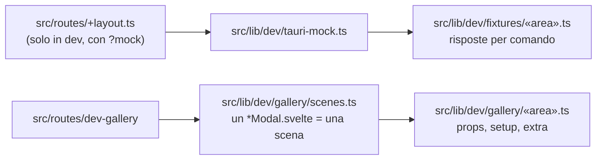

# UI gallery — le schermate nel browser, e il confronto fra due revisioni

> Il frontend di Arbor gira anche fuori da Tauri: un finto `window.__TAURI_INTERNALS__` risponde
> con dati di esempio, e una pagina di sviluppo monta ogni modale (e i pannelli principali) uno
> alla volta. Serve per **vedere** una schermata senza avviare l'app e per **confrontare due
> revisioni** del codice a livello di DOM.

> [!IMPORTANT] Solo sviluppo, mai in produzione
> Il mock e la galleria sono dietro `import.meta.env.DEV`. Un build di produzione non li include
> e la rotta `/dev-gallery` risponde 404.

## Avviarla

```bash
yarn gallery
```

Poi, nel browser:

| URL | Cosa mostra |
|---|---|
| `http://localhost:1420/?mock&label=main` | il launcher (con `label=bennu`, `corvus`… la finestra del prodotto) |
| `http://localhost:1420/dev-gallery?mock` | l'indice di tutte le scene |
| `http://localhost:1420/dev-gallery?mock&scene=corvus%2FCloneRepoModal` | una scena sola |

`vite.gallery.config.js` è la configurazione normale più un endpoint che salva gli snapshot;
`GALLERY_OUT` sceglie la cartella e `GALLERY_CACHE` la cache delle dipendenze (necessaria se si
tengono accese due gallerie sullo stesso `node_modules`).

## Come è fatta



- **Fixtures** — chiave = comando Tauri, oppure `programma.metodo` per `rpc`. I comandi senza
  risposta tornano `null` e finiscono in `window.__mock.missing`: è la lista di cosa aggiungere.
- **Scene** — ogni `*Modal.svelte` ha una scena automatica con props vuote; in
  `gallery/«area».ts` si danno props vere (`overrides`) e si aggiungono pannelli (`extras`).
- **`window.__gallery`** — `ids()`, `run(id)`, `runAll()`, `dumpAll()`.

## Confrontare due revisioni

1. `yarn gallery:baseline [ref]` esporta la revisione (default `HEAD`) in `.gallery-baseline/` con
   `git archive` — nessun checkout, il working tree non si tocca — vi sovrappone la galleria
   attuale e stampa i due comandi per avviare le gallerie, la prima sulla porta 1421 con una
   propria cache delle dipendenze, il working tree sulla 1420.
2. Su entrambe: aprire `/dev-gallery?mock`, con **la stessa dimensione di viewport**, ed eseguire
   `await window.__gallery.dumpAll()`.
3. `yarn gallery:diff <dump-prima> <dump-dopo>`.

Lo script ignora commenti di Svelte, spazi, hash CSS, orari e date, e separa le differenze di
**markup** da quelle di **solo stile** (hash CSS cambiato). `--strict` conta anche queste ultime.

> [!WARNING] Il viewport conta
> Liste virtualizzate e altezze di CodeMirror dipendono dalla dimensione della finestra: due dump a
> viewport diversi producono differenze che non sono regressioni.

> [!WARNING] Un componente che va in loop congela la scheda
> Se un comando risponde `null` e un `$effect` rilancia il caricamento su quel risultato, la pagina
> si pianta (era il caso di `BranchCleanupModal` e `BennuMojibakeScanModal`). Se la scheda si
> blocca, chiuderla e correggere prima la fixture.
