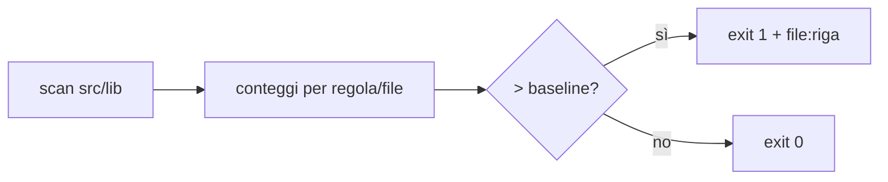

# UI lint (ratchet)

> Cosa fa `scripts/lint-ui.mjs` e come si tiene aggiornato. Per chi tocca `src/lib`.

Lo script (Node, zero dipendenze) scansiona `src/lib/**/*.{svelte,ts,css}` e conta le violazioni
di coerenza UI per regola e per file (commenti ignorati). È un **ratchet**: il pregresso è
congelato in `scripts/lint-ui.baseline.json`, e il check fallisce solo se un file *peggiora* o se
un file nuovo introduce violazioni. Ogni regola stampa `file:riga` e la forma corretta da usare.

- `node scripts/lint-ui.mjs` (o `yarn lint:ui`): verifica. Exit 0 ok, 1 regressione, 2 errore d'uso.
- `--list [regola]`: tutte le violazioni, anche quelle in baseline.
- `--update-baseline`: riscrive la baseline dai conteggi attuali.

> [!WARNING] La baseline si rigenera solo quando i numeri scendono
> Se il check fallisce, correggi il codice nuovo: alzare la baseline per far passare il check
> vanifica il ratchet. Quando il check segnala che i conteggi sono scesi, rigenera e committa il json.

**Aggiungere una regola**: in `RULES` aggiungi `{ id, ext, description, message, check }`, dove
`check({file, code, styles})` ritorna gli offset dei match (`code` ha i commenti svuotati);
`skipPath`/`onlyPath` restringono i file. Prova con `--list <id>` finché non ci sono falsi
positivi, poi `--update-baseline`. Meglio poche regole precise che molte rumorose.
